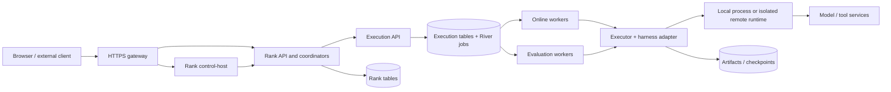
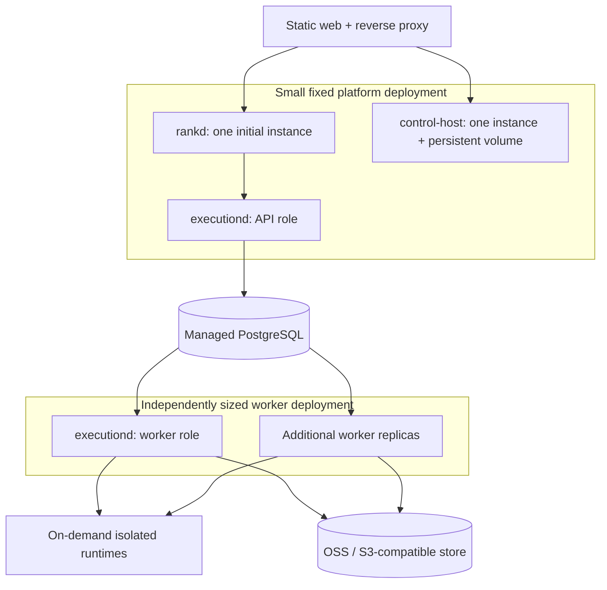

# Agent Note: Rank production execution and resource scaling

Status: proposed

English | [中文](2026-09-14-rank-production-execution.zh.md)

## Problem

Rank needs to serve real endpoint traffic while evaluations use the same harness capabilities. The execution capacity must grow independently of Agent count, endpoint count, and stored conversations. A failed worker must not lose an accepted request or silently repeat an external action. Local development must stay easy to start.

This is the consolidated implementation proposal, researched on 2026-09-14; it does not describe a completed production deployment. It extends the retained decisions on [control/execution separation](2026-08-18-rank-control-and-execution-planes.md) and [isolated harness execution](../../implemented/architecture/2026-08-19-rank-isolated-runner-plane.md). Their isolation and ownership rationale remains applicable; this proposal specifies queue technology, deployment stages, and failure behavior without replacing that rationale.

## Proposal

Use PostgreSQL and River OSS for production job delivery. Keep Rank's evaluation, release, conversation, and Execution state machines in the application. Separate Execution API and worker process roles, reuse the existing Executor and harness adapters, and scale workers first. Run only one `rankd` and one control-host in the first production stage until their background coordinators and native sessions support multiple owners safely.

Expose one Execution API to Rank. A remote sandbox is an implementation behind Executor, not another product-facing lifecycle service. Use the same immutable execution specifications, events, cancellation semantics, and results for local and remote execution. Keep HTTP JSON and SSE; a WebSocket protocol is not necessary for this workload.

Do not require Temporal, Redis, Kafka, Langfuse, Relay, Kubernetes, per-Agent images, per-conversation Pods, live process migration, or a pluggable scheduler framework. Add an external component only where it removes a demonstrated implementation or operations burden.

The [durable delivery implementation](../../implemented/architecture/2026-09-14-execution-river-delivery.md) covers Execution PostgreSQL/River roles, bounded concurrency, cancellation, recovery and S3 artifacts. [Rank business storage](../../implemented/architecture/2026-09-14-rank-postgres-storage.md) supplies the PostgreSQL repository and explicit migration. [Serving dispatch](../../implemented/architecture/2026-09-14-rank-serving-dispatch.md) freezes and recovers Responses and trials. [Evaluation dispatch](../../implemented/architecture/2026-09-14-rank-evaluation-dispatch.md) persists candidate/Judge intent and recovers original outcomes. [Model selection](../../implemented/architecture/2026-09-14-rank-frozen-model-selection.md) fixes connection defaults in Agent versions before admission. [Structured history](../../implemented/architecture/2026-09-14-rank-structured-history.md) preserves DSH conversation roles and tool pairing, rejecting unsupported adapters. [The complete platform lab](../../implemented/architecture/2026-09-14-rank-platform-lab.md) verifies gateway access, DSH endpoint calls, structured continuation and recovery after Pod replacement. Workspace access, remote-runtime restrictions and capacity projection have their own implementation records below; acceptance on the selected production infrastructure remains outstanding.

The [runtime cleanup reservation](../../implemented/architecture/2026-09-14-execution-runtime-cleanup.md) keeps model/tenant capacity for unknown attempts until shutdown is confirmed. The [OpenSandbox implementation](../../implemented/architecture/2026-09-15-execution-opensandbox.md) adds remote identity, terminal cleanup reconciliation and independently enforced container lifetime. Its [Docker/minikube experiment](../../../../rank/deploy/reports/2026-09-15-opensandbox.md) verifies packaged API/Worker execution, real DSH, endpoint/chat flows, S3 artifacts and recovery with the remote backend. The storage and egress profiles described below extend this backend. Their local verification does not establish physical-host capacity or production isolation.

The [capacity implementation](../../implemented/architecture/2026-09-15-execution-capacity.md) distinguishes eligible demand from concurrency-quota, capability and delivery blocking. `GET /v1/capacity` reads one database snapshot and virtually allocates remaining shared quota across queued work. The minikube experiment uses KEDA 2.20.2 Metrics API with a read-only token and a 1–3 worker bound; it does not add Prometheus or a custom autoscaler. API and workers share one homogeneous configuration. Active records are durable reservations, not live occupancy; queue-age samples are not historical latency percentiles. Provider RPM/TPM throttling and heterogeneous pools remain separate work. The [measured autoscaling run](../../../../rank/deploy/reports/2026-09-15-autoscaling.md) covers bounded worker growth, drain and concurrency-quota exclusion. Its remote Docker runtimes share a fixed host outside Kubernetes scheduling; more Worker controllers do not add sandbox-host capacity. Production placement must enforce available sandbox resources and reject or defer allocation when that capacity is exhausted.

[Frozen queue deadlines](../../implemented/architecture/2026-09-15-execution-queue-deadline.md) bound waiting independently of runtime duration. API reconciliation handles absent/disabled workers, claim checks reject expired work, and capacity excludes overdue demand. Rank-wide request deadlines remain separate work; sandbox resource admission is owned by the durable pool described below.

[Durable Sandbox resource admission](../../implemented/architecture/2026-09-15-execution-runtime-pool.md) freezes the service, image and resource limits at submission, and reserves an operator-assigned CPU/memory budget across Workers. Capacity excludes resource-blocked work from runnable demand. This controls allocations sharing one Execution database; it does not discover free host resources, enforce other clients' allocations or provision physical hosts.

## Current baseline and gaps

| Evidence in Rank | Implication for implementation |
| --- | --- |
| [Rank configures an Execution URL](../../../../rank/backend/cmd/rankd/main.go); [the client uses HTTP and SSE](../../../../execution/backend/client/client.go) | Rank and Execution may be placed on different hosts; this alone is not distributed worker scheduling. |
| [Execution API/worker roles](../../../../execution/backend/cmd/executiond/main.go); [River delivery](../../../../execution/backend/internal/dispatch/river.go) | Independent worker processes share durable jobs; the local Executor and optional OpenSandbox Executor share the API. Production isolation and remote deployment acceptance remain required. |
| [Local Executor starts a subprocess and removes its workspace](../../../../execution/backend/internal/executor/local.go) | Independent workspaces and bounded process cleanup are implemented. Cross-turn environment recovery is a separate capability; conversation history does not restore files or running processes. |
| [Serving structured history](../../../../rank/backend/internal/app/serving.go) | DSH supports messages and tool pairing; native Codex, Claude Code and Hermes history adapters remain unimplemented, with unsupported continuations explicitly rejected. |
| [Control-host owns live DSH sessions](../../../../apps/rank-web/control-host/src/main.mjs) | Keep a single owner with persistent storage initially. |
| [Workspace access](../../implemented/architecture/2026-09-15-rank-management-access.md) and [gateway routing](../../../../rank/deploy/k8s/gateway.conf) | Revocable operators, scoped internal calls and proxy SSE routes are implemented and tested locally. Validate TLS, configured browser origin and private service reachability on the production deployment. |

## What to reuse from Codex

The source review is pinned to [openai/codex at 3abbf9f](https://github.com/openai/codex/tree/3abbf9fe2c6b6910e9de61f6a0c5bb468f74b5c8). It establishes client, transport, and execution-host behavior, not OpenAI's complete cloud placement, autoscaling, or infrastructure scheduler. The following lessons are architectural observations, not a proposal to call private Codex cloud APIs.

| Observed mechanism | Rank decision |
| --- | --- |
| App-server distinguishes Thread, Turn, and Item; stored threads can be read without loading them [S1] | Distinguish Conversation, Response/Execution, and ordered events. Reading history does not allocate runtime resources. |
| Cloud task creation carries an environment, code ref, and optionally a starting diff; task IDs and attempts remain separate [S2] | Freeze the Agent/runtime revision and input references before dispatch. Environment selection is explicit internal configuration; workers do not discover an arbitrary current version. |
| Exec-server separates process/filesystem control from the harness and supports a remotely registered environment [S3] | Preserve Executor and harness separation. Workers in the private network pull jobs; do not introduce laptop enrollment or NAT traversal in the first version. |
| Forwarding does not persist execution state or replay requests; resumption depends on the destination [S3] | Reconnection, business-event replay, native-session resume, and workspace restore are distinct capabilities. None implies process-memory migration. |
| App-server bounds ingress and exposes overload; remote protocols have explicit identity and cursor handling [S1][S3] | Bound queues and event buffers, authenticate internal calls, and resume SSE by a durable sequence. Do not copy the transport's framing or retransmission protocol. |

The reviewed app-server documentation marks its command/WebSocket path experimental and unsupported for production [S1]. Rank keeps its present Codex adapter as the baseline and evaluates richer Codex integration separately. The relay in Codex's transport is also unrelated to NVIDIA NeMo Relay.

## Agents SDK and the harness layer

OpenAI Agents SDK runs the model/tool loop inside an application and provides handoffs, streamed events, approvals and session persistence [S8]. It overlaps the DSH/harness layer. A caller of a published Rank endpoint needs only the supported HTTP API; it does not need this framework. Keep DSH/Codex as the initial execution paths and add an Agents SDK harness adapter only for an accepted workload that needs it.

Reuse the separation of reusable Agent definition, per-run input/result, conversation history and workspace lifetime. Rank retains its conversation, authorization, evaluation and release records; an adapter maps SDK history, approvals, cancellation and events into the existing execution protocol. One owner persists each history to avoid duplicate context. SDK tracing is optional and does not become a second business record store.

Sandbox Agents provide workspace manifests, filesystem/shell capabilities and sandbox-session recovery, but the reviewed feature is beta [S8]. Evaluate it as part of an optional harness integration; it does not by itself isolate every DSH/Codex process or supply cluster task admission and replica scaling. Executor remains responsible for the complete runtime and confirmed cleanup; a cancelled SDK call is not proof that remote work stopped. Adding this adapter is outside the first worker-scaling delivery.

## Scheduler decision

| Option | Benefit | Cost and decision |
| --- | --- | --- |
| River OSS + PostgreSQL | Go workers, transactional enqueueing/completion, queues, configurable retries, cancellation, job rescue and cleanup [S4][S5] | Selected for production. No additional queue service; application-specific safety still belongs to Rank/Execution. |
| Kafka | Durable event streams, independent subscriber groups and replay [S9] | Deferred. Appropriate when billing, analytics or other services need independent event consumption. Using it for execution delivery still leaves job state, cancellation and retry policy to implement. |
| A custom PostgreSQL queue | Complete control and few initial lines | Declined for production: claiming is easy, but cancellation races, rescue, draining, retries, and upgrades create continuing ownership. The existing local dispatcher remains a development-only path. |
| Temporal | Durable workflows, timers, signals and activity execution [S7] | Deferred. The current release/regression flow is a bounded application state machine; operating a Temporal service or adopting Cloud adds another control system. Reconsider for substantial long-lived, cross-service workflows or an existing organizational Temporal platform. |
| Redis-backed queues or Kubernetes Jobs as the queue | Useful with an existing stack or coarse batch work | Not selected: Redis adds a second enqueue transaction domain; a Kubernetes Job is a compute resource and does not replace conversation ordering, quotas, or business idempotency. |

Temporal also offers Standalone Activities, documented as Public Preview during this review [S7]; it is not necessary to wrap every single task in a Workflow. The reason to defer is the current benefit/cost balance, not an inability to schedule Agent work. Temporal activity retry also does not make external side effects exactly once.

River owns job delivery; a harness owns the model/tool loop; the chosen infrastructure owns worker replicas. None replaces another. The daily-news demo submits a bounded execution when triggered, while chat submits work for each new turn without holding a worker between messages. Long task duration alone does not justify Temporal; durable cross-service coordination must remove enough application complexity. Kafka is not required to stream tokens to the caller.

River v0.47.0 uses MPL-2.0 and requires Go 1.26.0 [S4]. Both Rank Go modules use that toolchain. Real PostgreSQL tests and packaged API/worker examples verify the pinned version; the delivery decision documents the explicit migration procedure. Deployment acceptance and dependency license review remain part of production readiness.

River OSS worker counts are per process/queue. Cross-process partitioned concurrency is a River Pro feature [S6]. This design does not depend on Pro: endpoint admission stays in Rank; Execution applies a small database-backed tenant/model concurrency reservation before starting a runtime. Lack of a permit defers the job without occupying a running process. These are product admission rules, not a second job-claiming system. Release reservations only after confirmed stop, completion, or recovery reconciliation; uncertainty must not create extra capacity.

## Architecture and deployment



Arrows show the primary command/data path; results and SSE return through Execution and Rank. Rank tables and Execution/River tables may use one managed PostgreSQL cluster with separate schemas and credentials. They remain separately owned; no transaction crosses the Rank-to-Execution HTTP call. Trusted worker controllers access only Execution/River data, never Rank business tables. Untrusted harness processes receive neither database credentials nor worker service credentials.

Database ownership is separate from runtime access: each service has a migration owner and a restricted application login; schema-version tables remain read-only to running services. Migration Jobs receive only owner database credentials. Control hosts and untrusted Harness processes receive no database credentials. The [implemented lab decision](../../implemented/architecture/2026-09-15-rank-database-permissions.md) verifies this split without claiming production tenant authorization or credential rotation.



Use minikube as the local deployment acceptance target, with one Kubernetes manifest base and a small local overlay. Production can reuse that base on an existing cluster; the local experiment does not require commissioning a production Kubernetes platform. Add a worker by starting the same trusted worker image with its database, storage and queue configuration; no new registration service is required. SQL connections must use a private authenticated network, not a public database exposed to end-user devices.

`executiond` gains `api`, `worker`, and local `all` process roles; `execution-worker` remains the per-invocation child process. Online and evaluation queues share code but have separate concurrency budgets; split their replica pools when batch work would interfere with online latency. Resolve harness/runtime capabilities into explicit queues or startup-validated worker configurations; a worker must never claim a task it cannot execute. Avoid one queue per tenant or Agent.

Local lightweight mode retains SQLite and local files, with bounded single-host execution. Production-like development uses minikube with PostgreSQL and River, running the same distributed path as production. Both modes run the same execution conformance suite; SQLite mode does not claim multi-host recovery guarantees. Do not maintain a second Compose deployment for the same acceptance scenarios. Rank local-model discovery examines the Execution host or container, not the user's browser device; the lab configures its model connection explicitly instead of mounting the laptop's home directory.

## Task lifecycle and failure rules

An Execution is one bounded candidate, judge, or serving invocation. A Conversation contains many Responses, and a workspace may outlive one Execution. Waits for a user message, caller tool result, or release confirmation must not hold a River worker slot. Persist the wait in the appropriate Rank state and enqueue the next bounded execution when its input arrives. A multi-turn evaluation fixes its case/Trial identity across turns and resumes from committed turn results.

| Step | Required behavior |
| --- | --- |
| Admission | Rank checks tenant, endpoint, conversation head and queue limits; freezes input; durably records dispatch intent. Overload is an explicit retryable API error, not an unbounded queue. |
| Submission | Rank retries delivery with a stable logical execution key. Execution inserts its record and River job in one database transaction. The same key/spec returns the same ID; a changed spec with the same key is rejected. |
| Claim | River owns claiming and job recovery. The worker reads the Execution, validates runtime capability, acquires product quota, and conditionally records an attempt generation before runtime start. |
| Execution | Enforce run timeout and an independent runtime lifetime. Persist ordered normalized events before making them available to SSE. Keep native logs linked to the exact attempt. |
| Completion | Upload required immutable artifacts first, then atomically publish their references, terminal Execution state and River completion in the Execution database. No database transaction remains open during an LLM call. |
| Re-delivery | A terminal Execution returns without launching a harness. An already-started attempt is reconciled; job re-delivery is not permission to rerun model or tool work. |
| Cancellation | Persist cancellation intent, signal River and the runtime, and stop the process tree/environment. Poll durable intent as a fallback to notifications. A cancellation signal alone is not evidence of quiescence. |
| Owner loss | Reject stale-attempt events and results. Reconcile the runtime and artifacts; unresolved side effects produce a failed Execution with an explicit unknown-outcome reason. Never present it as a quality failure or successful completion. |

River is at-least-once [S5]. Every Work entry checks authoritative Execution state. Default serving policy does not automatically repeat a started invocation with an uncertain outcome; pre-start retry and explicitly replayable isolated evaluations may retry within a bounded policy. Retain failed attempts and their known usage. Native harness/model retries and queue retries share an overall budget so their multiplication cannot cause uncontrolled cost.

Configure job timeout, subprocess/sandbox hard lifetime, rescue delay and shutdown grace together. River's rescuer can requeue a still-running job after its configured threshold [S5]; use a rescue threshold beyond the bounded execution/cleanup interval and test owner loss. Attempt generation fencing protects Rank's stored results; it cannot undo an external HTTP action. If the old runtime cannot be proved stopped, do not start a second attempt against the same mutable workspace. Do not build a separate generic heartbeat/lease scheduler alongside River.

Browser or SSE disconnection does not cancel the durable task. Clients reconnect by event sequence and may explicitly cancel. A reverse proxy disables SSE buffering and has a configured streaming timeout. Internal notifications accelerate delivery; the database remains the replay source. A small reconciler repairs Execution projections when a River job is discarded or cancelled before application cleanup can publish its final state.

## Durable Rank dispatch and recovery

A single `rankd` prevents competing coordinators but does not prevent lost dispatch after a crash. Rank saves the Response/Trial and dispatch intent in one business transaction. The intent contains a stable logical key, the complete immutable Execution Spec, its business association and cancellation intent. Recovery resubmits or queries unfinished intents using the original key and input; it must not reconstruct requests from current endpoint policy, Agent configuration or model defaults. Policy changes affect subsequent requests only.

If Execution accepts a request but its HTTP response is lost, retrying the same key/spec retrieves the original Execution ID. Rank persists cancellation even before that ID is known; recovery obtains the ID and forwards cancellation. Browser disconnection, SSE loss, internal HTTP timeouts and platform shutdown do not determine an execution outcome. Only an authoritative result or explicit recovery conclusion finalizes the business record. Event processing persists the committed sequence so duplicate events cannot append messages, tool results or cost twice.

The first implementation needs a fixed PostgreSQL repository and a single-owner dispatch coordinator, not a generic workflow framework. PostgreSQL and SQLite may share portable business queries while owning explicit migrations. Real database transactions must verify admission, conversation-head updates and event sequence allocation; executable SQL alone does not establish matching concurrency. Initial production starts with a fresh database. Migrating existing SQLite data requires a separately verified explicit tool, never implicit startup conversion.

Acceptance covers crashes after business commit, before the submit HTTP response, before saving the Execution ID, and before committing the result, plus cancellation during dispatch, policy edits before recovery and duplicate SSE events. Evaluation delivery retries retain the same logical key; an explicit user rerun creates a new logical invocation. Platform restart must not repeat committed success or confirmed external operations.

## Runtime, session and storage

Use the existing Executor as the single execution extension point. Start with local execution for trusted development and one isolated whole-runtime backend for untrusted production CLI/code. Evaluate OpenSandbox's maintained SDK/API for that backend; do not build a parallel Sandbox Service exposed to Rank. The existing E2B POC moves DSH filesystem/subprocess tools only and is not a replacement for whole-harness isolation.

First production scope includes one-shot jobs and multi-turn text/tool conversations whose state can be reconstructed from committed inputs. Browser/process-memory retention, automatic hibernation and live local/cloud handoff are excluded. Where a task requires cross-turn files, retain an explicitly identified workspace or restore a supported checkpoint; reject unsupported capabilities rather than silently switching runtime or losing files. Extend to retained environments only when an accepted workflow needs them.

| Data | Initial storage | Authority and retention |
| --- | --- | --- |
| Agent/Dataset versions, Runs, releases, Conversations and Responses | PostgreSQL; SQLite in lightweight mode | Rank-owned business truth and access control. |
| Execution specs, normalized events, attempt state and artifact references | Execution PostgreSQL schema | Execution-owned task truth. River job cleanup must not delete this history. |
| Structured input/output/tool history | Owning Rank/Execution records | Used for portable history and evaluation; do not encode role semantics only inside a prompt string. |
| Native harness logs and resume checkpoints | Persistent local storage, then object-store artifacts | Native reconstruction evidence, bound to runtime version/attempt; not another authority for release or response status. |
| Attachments, generated files and large outputs | One OSS or S3-compatible backend | Immutable keys, checksums and database references; use signed short-lived URLs after authorization. |
| Active working files | Sandbox filesystem or explicitly retained volume | Objects are downloaded/uploaded around execution; object-store FUSE mounts are not the default working filesystem. |

Choose one OSS or S3-compatible object service for the deployment. The local lab selects SeaweedFS v4.47; the MinIO server repository is archived as checked on 2026-09-14 [S11]. The maintained MinIO Go S3 client is a separate dependency and does not require a MinIO server. MinIO is an object service, while PVC is a Pod volume mechanism; they are not interchangeable storage APIs. Keep an ArtifactStore interface with only put/read/delete/sign operations required by Rank. After a failed database reference commit, orphan objects can be collected after a grace period. Referenced evaluation evidence and checkpoints are retained according to their owning records, not deleted with an unrelated chat view.

Retain the control-host's native DSH log and single writer on a persistent volume initially. Its memory cache does not become distributed merely by adding an object store. Future control-host replication needs explicit session routing and single-owner coordination. Likewise, `rankd` evaluation/release/webhook coordinators need durable claims before API replication. These changes are independent of worker scaling and must precede an HA claim.

### Sandbox adapter acceptance

OpenSandbox source at [07f0a68](https://github.com/opensandbox-group/OpenSandbox/tree/07f0a68dd230d5498645df2fbd0d5174b3edb5c1) supplies a Go SDK for lifecycle, streamed commands and files. Its [server documentation](https://github.com/opensandbox-group/OpenSandbox/blob/07f0a68dd230d5498645df2fbd0d5174b3edb5c1/docs/components/server.md) distinguishes deletion, absolute expiration and pause/resume. The optional adapter and separate Docker lab are implemented; their current scope is recorded in the [decision](../../implemented/architecture/2026-09-15-execution-opensandbox.md). The complete minikube platform lab selects local subprocesses or the remote adapter through an explicit maintenance upgrade.

A separate [Docker probe](../../../../rank/deploy/reports/2026-09-14-opensandbox-probe.json) pins server 0.2.3 and execd v1.1.0 (`48b0215`, image digest in the report). That release rejects argv-only commands despite the newer SDK field; UID/GID and environment overrides work. Commands inherit the daemon token unless explicitly cleared. After clearing it, a UID 1000 command could neither read the root process environment nor signal root PID 1; unauthenticated commands returned 401. A root-owned 15-second timeout stopped the sandbox and its TERM-ignoring background command after the lifecycle server was killed, despite a 90-second server TTL. This smoke does not establish persisted absolute deadlines, full Harness isolation, sidecar cleanup or adapter recovery. Remove daemon credentials from command environments, restrict daemon files, and keep optional SDK retries disabled for non-idempotent creation/commands.

Before issuing a command, the adapter must record the remote runtime ID separately from its worker owner. Creation metadata correlates Execution ID and attempt but does not guarantee idempotency; reconcile a lost create response without blindly repeating creation or the command. Start no work while ownership is ambiguous. Configure resources and expiration without access renewal; verify runtime death during worker, lifecycle-server and network failure instead of assuming a server TTL timer is an independent hard deadline.

Cancellation uses a separate bounded cleanup context after the execution context ends. A stopped stream does not prove a stopped process. Docker DELETE can return 404 while orphan sidecar cleanup is still best effort; confirm application termination and required dependent-resource cleanup before releasing retained capacity. Upload evidence before normal destruction; unconfirmed cleanup or external effects retain an unknown outcome. Isolation failure never falls back automatically to local execution.

## Capacity, extensibility and operations

The operator sets worker slots, queue admission limit/wait deadline, execution timeout, tenant/endpoint/model quotas, runtime resource limits and min/max replicas. Treat these as validated deployment configuration. For mean arrival rate lambda and mean execution duration W, lambda × W estimates average in-flight work; it is not a tail-latency or Pod-sizing guarantee. Measure process memory, CPU, startup cost and provider limits using the daily-news and chat demos before setting slots.

Scale from eligible slot demand, using runnable queue age for diagnosis and CPU/memory as constraints. Exclude work deferred for model quota or missing capabilities from the capacity backlog signal. Keep an online minimum of one warm worker, cap replicas by cost/model budget, and drain workers before scale-down. The acceptance load records arrival rate, p95 queue delay, time to first output, completion rate, cancellation latency and cost. The local Kubernetes experiment uses KEDA Metrics API; it neither creates per-task isolation nor raises provider limits.

The provider-limit increment must count actual model requests, including retries and auxiliary calls, rather than Executions. Execution owns shared admission backed by PostgreSQL. Operator-configured quota groups combine connections that consume the same provider allowance; a connection ID alone cannot enforce account-wide limits when several connections share that account. Start with DSH's controllable request path. An adapter unable to enforce a configured limit must reject that configuration before execution; do not claim CLI-wide enforcement from counting job submissions.

RPM bounds request starts over the configured window. TPM requires a documented provider-specific accounting rule: reserve estimated input plus a bounded output allowance before sending, reconcile reported usage, and retain a conservative reservation when usage is unknown. Label estimates; do not claim exact provider accounting or a hard monetary budget. Honor provider retry delays within the remaining execution deadline and request-attempt budget. Waiting before runtime startup must not increase runnable scaling demand. Waiting inside an already-running harness still consumes its slot and runtime budget; freeing that slot would require separately designed resumable execution.

| Keep extensible | Keep fixed in the first version |
| --- | --- |
| Harness adapters and explicit capabilities: structured history, native resume, attachments, external tools | Rank's Agent/Dataset/Run/release/Conversation relationships and version rules |
| Executor implementations: local or one remote isolated runtime | HTTP JSON + SSE and one versioned Execution event protocol |
| ArtifactStore and model/provider adapters | PostgreSQL + River for the production queue; no multi-scheduler abstraction |
| Optional telemetry exporter derived from existing events | No mandatory Langfuse/NeMo Relay and no second event collector |

Normalize event identity with execution ID, attempt, per-execution sequence, event type and protocol version; store model-connection references rather than secrets. Propagate tenant and conversation/Run IDs without treating client-supplied IDs as authorization. Worker and runtime versions are recorded with each attempt. Native details that cannot be represented portably stay in typed adapter metadata or referenced logs, not fabricated generic fields.

Production requires authenticated Rank/control-host access, authenticated private Execution APIs, scoped worker credentials, transient model credentials, non-root/restricted runtime permissions, network egress controls and bounded CPU/memory/disk. The chosen runtime must stop on its own deadline if its worker disappears. Model credentials remain in the Execution credential store and must not enter River arguments, persistent request dumps, telemetry or snapshots. An Agent is not assigned a permanent Pod or image; runtime images are versioned by executable capabilities.

### Shared provider quota implementation

The PostgreSQL quota repository serializes permits for connections in the same configured account group. DSH uses its existing LLM-stream extension point, so retries and auxiliary requests share the same rate allowance without introducing a model gateway or scheduler. Invocation-only HMAC identities authorize quota callbacks; the signing key remains in trusted API/Workers and request artifacts omit the transient identity. Runtime callback timeout is explicit. Groups and output caps freeze in accepted Executions while rate edits retain current debits. Configuration races reject admission; member changes require drained work and expired windows.

The [quota example](../../../../rank/examples/model-quota/README.md) specifies the conservative token estimate, positive-usage reconciliation, shared accounting window and pre-start capacity projection. Running quota waits still occupy runtime slots. SQLite and unsupported adapters reject the feature. This preserves the lightweight path without pretending that in-memory limits coordinate independent hosts. A general-purpose gateway or resumable waiting scheduler is deliberately deferred: the current DSH extension and existing PostgreSQL transactions cover the owned execution path. Exact provider billing, raw tool traffic and malicious plugin bypass remain outside this cooperative limit.

### Conversation history and optional tracing

Rank conversation records answer what the user sent, what the Agent returned and which committed response continues the conversation. Execution records establish task state, cancellation, ordered event replay and artifact ownership. Neither record may depend on a tracing service being available.

Optional tracing answers where time and cost were spent across admission, queueing, model calls and tools. Export spans from recorded events using conversation, response, execution and attempt identities; mark missing measurements as unavailable. Export failure must not change a business result or authorize replay. Apply separate retention, access controls and redaction to telemetry; historical conversation access must remain available if telemetry is sampled or deleted. Langfuse/NeMo Relay selection is deferred until a concrete analysis or collection requirement justifies an integration; do not install both by default or treat either as the conversation store.

## Delivery stages

| Stage | Deliverable | Exit condition |
| --- | --- | --- |
| 1. Establish capacity and queue fit | Repeatable demo load, bounded local concurrency, River/Go/PostgreSQL spike, durable dispatch/idempotency design | A real Execution API submits through PostgreSQL to two separate worker processes; prove duplicate submission, cancellation and safe rescue with the pinned library. Record the baseline and prerequisites. |
| 2. Scale actual workers | PostgreSQL repositories, Execution API/worker roles, online/evaluation queues, artifact backend, internal authentication, structured history adapter support | Daily-news and chat run through the minikube gateway; workers run on distinct simulated nodes when resources allow. A separate cross-host run verifies throughput up to a measured external bottleneck. |
| 3. Open isolated production workloads | One whole-runtime sandbox backend, scoped credentials, hard lifetime and cleanup | Prove workspace isolation, stopped children, interrupted uploads, owner loss and explicit unknown outcomes before admitting untrusted code. |
| 4. Automate measured capacity | Queue/slot metrics, graceful rolling updates and bounded replica scaling on the chosen infrastructure | A load rise and fall scales compute, keeps accepted work accountable, and leaves no leaked runtimes. |

The first release can keep `rankd` and control-host on one platform host and add compute hosts independently. It trades platform-host HA for a small implementation; document this operational limit. Do not treat a multi-worker test as proof that the whole platform survives every host failure.

Continue from the existing backend and the [verified tool/owner-loss scenarios](../../../../rank/deploy/reports/2026-09-15-owner-loss.md). Durable pool admission bounds assigned resources; independent lifecycle clients must share that authority or receive a separate host budget. Shared provider limits and the remaining persistence windows have local acceptance evidence below. Validate the implemented access, storage and egress controls on the selected production hosts before opening traffic.

The [failure-evidence implementation](../../implemented/architecture/2026-09-15-execution-failure-evidence.md) retains observed output, usage and confirmed artifact references independently of terminal success. Binary previews have explicit encoding. The [dependency experiment](../../../../rank/deploy/k8s/README.md#dependency-interruption-experiment) covers PostgreSQL loss during a real tool call and interrupted S3 request bodies after one confirmed upload. It does not prove storage failover or eliminate the window between an object commit and its database reference.

The [database deadline implementation](../../implemented/architecture/2026-09-15-postgres-deadlines.md) bounds PostgreSQL acquisition, query I/O and application transactions without imposing a short total timeout on model calls or SSE. Dependency verification requires a bounded server response during database absence; client timeout alone is not acceptance evidence. Timeouts preserve existing identity and unknown-outcome rules, rather than authorizing replay.

The [bounded-storage profile](../../implemented/architecture/2026-09-15-sandbox-storage.md) configures the dedicated Docker lab with read-only image files, capped ephemeral writable areas and rejected extra mounts. Native-process exhaustion and platform regressions establish this local profile. The egress profile below complements it; target-host validation and any persistent workspace quotas remain deployment requirements.

The [egress implementation](../../implemented/architecture/2026-09-15-sandbox-egress.md) freezes destination CIDRs/ports in each runtime plan and installs kernel rules before accepting commands. The dedicated lab verifies reachable allowed targets, denied native TCP/UDP traffic and continued enforcement after lifecycle-service loss. This is transport enforcement; production identity, incoming tenant isolation, dynamic domain authorization and physical-host capacity still need their own acceptance.

[Frozen DSH model budgets](../../implemented/architecture/2026-09-15-execution-model-budget.md) cap total model-stream attempts across calls and retries within one execution. The accepted limit persists across default changes, and unsupported adapters cannot silently accept a requested budget. This application control is separate from shared provider RPM/TPM, token/cost budgets and hostile-code network isolation.

[Workspace operator access](../../implemented/architecture/2026-09-15-rank-management-access.md) protects Rank and control-host with independent, revocable operator identities and a scoped control-service token. Publication uses the authenticated operator. Public credentials retain tenant/endpoint/operation enforcement. Shared Agent and Dataset definitions do not have team ownership. The first release serves a controlled shared workspace; team-isolated SaaS and enterprise SSO require a separate product decision. Deployment must specify private service access and credential replacement; comprehensive audit and workload identity integrations are not prerequisites for the local scaling experiment.

### Local implementation acceptance

Treat the runnable local platform as the regression baseline. The [management-access report](../../../../rank/deploy/reports/2026-09-15-management-access.md) records ten passing integrated checks, including news/chat, authorization and restart recovery. Keep fixture acceptance, real-provider acceptance and production deployment acceptance separate; the bounded DeepSeek run covers real-provider integration while production-host verification remains external. Do not add another scheduler or Agent framework to complete this sequence.

| Increment | Deliverable and acceptance |
| --- | --- |
| 1. Provider limits | Enforce shared connection/provider RPM and TPM across Workers, with bounded waiting and explicit overload. Verify that rate-limited demand does not cause compute expansion; run the two demos against an explicitly configured real provider with a fixed budget. The per-Execution DSH request cap remains a separate protection. |
| 2. Remaining recovery windows | Interrupt object publication before its database reference commits, combine dependency loss with Worker loss, and verify fresh-database migrations and runtime-account permissions. Preserve known results, avoid replaying uncertain effects, and identify recoverable orphan objects. |
| 3. Automatic capacity acceptance | Exercise KEDA-driven scale-down with active work using the same limits and cleanup checks as manual drain. Verify task outcomes and released runtime capacity, not only Pod counts. |
| 4. Deployment acceptance | The operator owns physical multi-host capacity validation; it is excluded from this implementation acceptance. Verify the local deployment and document production storage, gateway TLS, browser origin, private service access and credential replacement requirements. Publish throughput, queue latency, resource ceilings and the remaining single-owner availability limits. |

The [local completion report](../../../../rank/deploy/reports/2026-09-15-production-local.md) records passing shared-quota, real DeepSeek news/chat, combined failure, orphan-object, fresh migration, runtime-permission and KEDA active-drain checks. The [production deployment reference](../../../../rank/deploy/k8s/production.md) captures the remaining operator work. Physical multi-host capacity, production TLS and infrastructure availability are not claimed as tested.

Real-provider acceptance uses the operator-authorized DeepSeek connection with an explicit request/output cap; credentials stay outside the repository and reports. Physical multi-host results remain operator-supplied evidence, not a prerequisite for completing the local implementation.

Each increment updates its owning implementation note and produces a reproducible report with exact images and prerequisites. Complete locally reproducible acceptance before declaring that increment done. Record unavailable production hosts or provider credentials as specific evidence gaps; they do not prevent independent local work or justify simulating production results.

## Local Kubernetes implementation experiment

The [lab tutorial](../../../../rank/deploy/k8s/README.md) supplies build, deployment and acceptance commands for both Execution fixtures and the complete platform. The [platform report](../../../../rank/deploy/reports/2026-09-14-platform.md) records deterministic news, chat, control and restart-recovery evidence; this section retains further isolation, capacity and failure acceptance requirements. Use an isolated `rank-dev` minikube profile and namespace with the Docker driver [S10]. Start with one node, 4 CPUs and 4 GiB of memory as a provisional budget, checked against Docker Desktop's available resources. Build native `linux/arm64` images on Apple Silicon and verify the production architecture separately. Record toolchain, image digests and resource settings with each run; these settings are not production sizing claims.

After minikube is installed, cluster bootstrap uses the following commands. Application deployment commands are in the linked lab tutorial. Use a dedicated kubeconfig so bootstrap and subsequent commands do not select an unrelated cluster.

```sh
mkdir -p "$HOME/.local/state/agentkiln/rank-k8s"
KUBECONFIG="$HOME/.local/state/agentkiln/rank-k8s/config" minikube start -p rank-dev --driver=docker --cpus=4 --memory=4096
kubectl --kubeconfig="$HOME/.local/state/agentkiln/rank-k8s/config" --context=rank-dev get nodes
```

Keep kubeconfig and credentials outside the repository. Keep application manifests under `rank/deploy/k8s` with installer-injected lab images and runtime settings applied through `kubectl apply`; the base experiment needs no application Helm chart, custom operator or Kafka/Temporal installation. The optional autoscaling experiment installs the pinned official KEDA Helm chart and its cluster resources. Load built images into the profile and verify their digests instead of relying on mutable `latest` tags.

| Lab resource | Initial placement and role |
| --- | --- |
| Web gateway, `rankd`, control-host, Execution API | One replica each. Gateway exposes browser/API/SSE routes through one loopback port-forward. `rankd` and control-host use a recreate update strategy to preserve their single-owner assumption. |
| Execution workers | Two replicas initially, each with one online slot and one evaluation slot for controlled tests; validate resource requests/limits. The local backend runs trusted fixtures inside the worker Pod; `--sandbox` selects the separate Docker runtime service with frozen resource and egress limits. |
| PostgreSQL | One lab instance with a persistent volume; Rank/Execution use separate schemas, restricted runtime logins and dedicated migration owners. The [privilege experiment](../../../../rank/deploy/k8s/README.md#database-permission-experiment) verifies cross-service denial and read-only migration metadata; production identity and credential rotation remain separate work. Schema/River migration Jobs finish before serving traffic; inspect migration state before explicitly retrying a failure. |
| Object service and control-host files | SeaweedFS v4.47 S3-compatible development service plus persistent control-host storage. The Execution lab verifies S3 and retained objects after service/cluster restarts; the complete platform lab verifies native control-session resumption from its volume after Pod replacement. |

A shared worker Pod is not per-task isolation. Before untrusted workloads, the chosen Executor backend must run the complete harness with the isolation and lifetime rules above. Persistent services remain on the initial node during multi-node experiments; the default minikube host-path provisioner does not support general multi-node volume placement [S10]. Add a second node only after checking the Docker memory budget, and explicitly place worker replicas on different nodes. Simulated nodes on one laptop demonstrate distribution and failure handling, not independent-machine capacity or storage HA.

Implementation and verification proceed in this order:

1. Deliver a vertical Execution slice: PostgreSQL persistence, River transactional submit/complete, API/worker roles, stable logical keys, authenticated internal calls, attempts and confirmed cancellation. Exercise a deterministic harness through the real process adapter; a standalone River hello-world is insufficient.
2. Package the slice, migration step and local dependencies, then connect Rank and the two existing demos through the gateway. Persist structured chat history and artifacts, verify SSE reconnect, and restart platform Pods to check dispatch recovery and saved history. Complete keyless fixture runs before bounded real-model calls.
3. Compare one and two worker replicas with identical slot settings and a controlled I/O workload; record queue wait and observed concurrency. Test online/evaluation separation and global product quotas. More queued work caused by model throttling must not be reported as insufficient compute.
4. Inject duplicate submissions, worker loss before start/during a tool call/after result commit, database unavailability and object upload failure. Recover services and assert the existing acceptance criteria; do not silently rerun calls with uncertain external effects.
5. Scale down from two replicas to one and perform a rolling update. SIGTERM stops new claims and drains active work within a configured grace interval; expiry interrupts work with an explicit state. Reject late events and account for every runtime. Add a second simulated node only for placement and worker-node loss tests.
6. After manual scaling passes, use the implemented eligible-demand, queue-age and configured-slot metrics with KEDA Metrics API. The bounded load rise/fall and application-concurrency exclusion are measured; shared provider quota exclusion has a separate KEDA observation. [Active-task experiments](../../../../rank/deploy/reports/2026-09-15-active-drain.md) verify manual scale-down and rolling replacement, including grace-expiry interruption; the [local completion report](../../../../rank/deploy/reports/2026-09-15-production-local.md) adds forced selection of an active owner by KEDA, with both grace completion and expiry. Automatic scaling is optional for the first runnable slice.

Each acceptance run produces a compact report containing revision/image digests, topology, resource/timeout/slot settings, demo results, latency/concurrency measurements and failure outcomes. Preserve database/artifact evidence across Pod replacement and stop/start of the lab; profile or volume deletion is an explicit data reset. A green minikube run permits the next deployment trial, not a production HA or untrusted-isolation claim.

## Alternatives considered

**Adopt Codex's remote protocol and cloud clients wholesale.** The reviewed code contains useful environment, event and resume concepts, but its cloud routes/authentication depend on external services. Its transport is not a reusable disclosure of OpenAI's resource scheduler. Rank keeps its working API and adopts the semantics that address its own workloads.

**Introduce Temporal immediately.** Appropriate when durable workflows, long human waits, signals, compensation, and cross-service coordination dominate maintenance, or the organization already operates it. Deferred while the workload is bounded execution plus a small release state machine; neither Temporal nor River resumes arbitrary process memory or removes tool idempotency requirements.

**Build a small custom distributed scheduler.** Avoids a dependency but retains the difficult failure cases. River removes queue mechanics while preserving the application-specific execution safeguards we must own anyway. No generic scheduler-provider interface is added for a hypothetical second implementation.

**Expose Execution and Sandbox as peer lifecycle APIs.** Splits cancellation, ownership and cleanup across two public interfaces before there is a reuse requirement. Rank uses Execution; Executor owns environment allocation and release internally.

**Allocate a persistent Pod to every Agent or conversation.** Wastes resources on configuration and idle history. Allocate by active execution and explicit stateful-workspace needs; benchmark cases/Trials remain isolated.

**Replicate every existing service or add Kubernetes before measuring.** Current background coordinators and control sessions have single-owner assumptions. More replicas can duplicate work, and more Pods do not fix provider throttling. Worker-only expansion first provides a measurable capacity change.

## Acceptance criteria

- A transaction rollback creates neither an accepted Execution nor a runnable River job; repeated dispatch with the same key/spec yields one logical Execution.
- A browser reconnect replays committed events without starting another invocation. Unsupported history or workspace capabilities fail before execution.
- Two worker processes cannot publish competing terminal outcomes; delayed events from an old attempt are rejected. A successful result committed before a delivery retry never relaunches the harness.
- Queued cancellation prevents launch; running cancellation terminates descendants or the remote runtime. A completion/cancel race resolves from durable state and confirmed quiescence.
- Killing a worker before start, during a tool call and after runtime completion produces a documented outcome. Unknown external effects are surfaced and are not automatically replayed.
- Database loss, object-upload failure and late runtime completion leave accepted work discoverable and artifacts accountable. Rescue settings cannot silently run two writers against one workspace.
- Online and evaluation limits work across worker replicas; model throttling does not trigger unlimited scaling or retry multiplication.
- The daily-news and chat demos run through both lightweight local and production-like modes, including structured multi-turn history and SSE reconnection. Saved conversations can become generic Dataset cases; replay uses newly generated replies, independent expectations and isolated Trials before release regression.
- Load testing records the baseline, slots and scaling thresholds; scale-down drains or explicitly interrupts work and leaves no unmanaged environment. Source mode, packaged binaries and the selected runtime pass the same keyless protocol/snapshot scenarios, with real-provider e2e for supported integrations.

## Risks

River's Go requirement and PostgreSQL migration add real initial work. The design uses its OSS features only; advanced global queue partitioning is not assumed. Native CLI histories and runtime snapshots are not portable across arbitrary versions. Attempt fencing cannot prevent a disconnected external service from finishing an already-issued action, so recovery may require an explicit user retry. Model quotas can limit throughput independently of CPU. Keeping platform services single-owner limits availability until their coordinators are made distributable.

No latency, concurrency or cost target is claimed as achieved by this document. Source review, queue-library validation, cross-host execution tests, sandbox conformance and production load testing are separate evidence requirements.

## Sources

- S1: [Codex App Server official documentation](https://developers.openai.com/codex/app-server), accessed 2026-09-14: Thread/Turn/Item, transports, bounded ingress and experimental remote support.
- S2: Codex [CloudBackend API](https://github.com/openai/codex/blob/3abbf9fe2c6b6910e9de61f6a0c5bb468f74b5c8/codex-rs/cloud-tasks-client/src/api.rs) and [HTTP implementation](https://github.com/openai/codex/blob/3abbf9fe2c6b6910e9de61f6a0c5bb468f74b5c8/codex-rs/cloud-tasks-client/src/http.rs): task identity, environment/ref/diff input and attempts.
- S3: Codex [exec-server README](https://github.com/openai/codex/blob/3abbf9fe2c6b6910e9de61f6a0c5bb468f74b5c8/codex-rs/exec-server/README.md): process/filesystem API, remote registration, forwarding, reliability and destination-owned recovery.
- S4: River [v0.47.0](https://github.com/riverqueue/river/releases/tag/v0.47.0), [Go requirement](https://github.com/riverqueue/river/blob/v0.47.0/go.mod), [license](https://github.com/riverqueue/river/blob/v0.47.0/LICENSE), and [transactional enqueueing](https://riverqueue.com/docs/transactional-enqueueing).
- S5: River [reliable workers](https://riverqueue.com/docs/reliable-workers), [cancelling jobs](https://riverqueue.com/docs/cancelling-jobs), and [maintenance/rescue](https://riverqueue.com/docs/maintenance-services). The dedicated cancellation page is used where older wording on the reliable-workers page differs.
- S6: River [Pro concurrency limits](https://riverqueue.com/docs/pro/concurrency-limits): cross-process global and partitioned limits are not OSS MaxWorkers.
- S7: Temporal [Workflow Execution](https://docs.temporal.io/workflow-execution), [Activity Execution](https://docs.temporal.io/activity-execution), and [Standalone Activity](https://docs.temporal.io/standalone-activity), accessed 2026-09-14.
- S8: [OpenAI Agents SDK repository](https://github.com/openai/openai-agents-js), [runner and state management](https://openai.github.io/openai-agents-js/guides/running-agents/), and [Sandbox Agents beta](https://openai.github.io/openai-agents-js/guides/sandbox-agents/), accessed 2026-09-14.
- S9: [Apache Kafka introduction](https://kafka.apache.org/intro): durable event streams, independent subscribers and replay.
- S10: minikube [startup](https://minikube.sigs.k8s.io/docs/start/), [Docker driver](https://minikube.sigs.k8s.io/docs/drivers/docker/), and [multi-node storage caveat](https://minikube.sigs.k8s.io/docs/tutorials/multi_node/), accessed 2026-09-14.
- S11: [MinIO server repository](https://github.com/minio/minio) archive status and [SeaweedFS v4.47](https://github.com/seaweedfs/seaweedfs/releases/tag/4.47), checked 2026-09-14; [SeaweedFS mini quick start](https://github.com/seaweedfs/seaweedfs/tree/4.47#quick-start).
