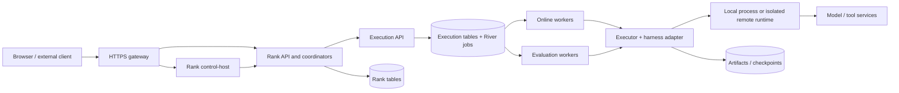
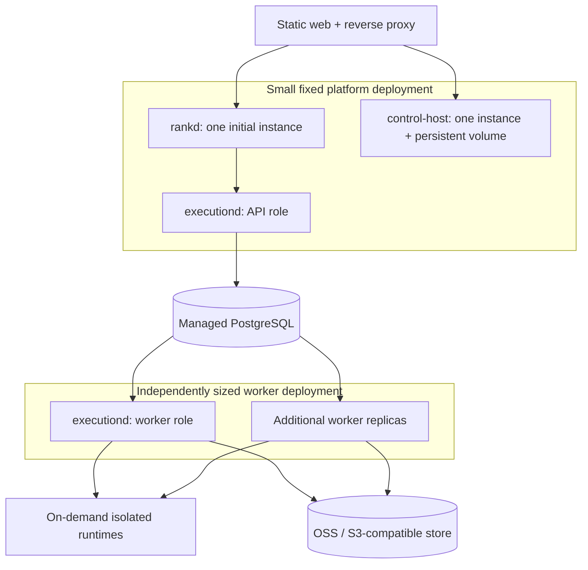

# Agent Note: Rank 生产执行与资源扩缩容设计

Status: proposed

[English](2026-09-14-rank-production-execution.md) | 中文

## 问题

Rank 需要承接真实端点流量，评测也需要使用相同的 Harness 能力。执行容量应随活跃任务增长，而不随 Agent 数量、端点数量和历史会话数量增长。Worker 故障不能丢失已接受的请求，也不能悄悄重复外部操作。本地开发仍需容易启动。

这是基于 2026-09-14 调研形成的最终实施提案，不表示生产部署已经完成。它延续保留的[中控与执行分离](2026-08-18-rank-control-and-execution-planes.md)及[隔离 Harness 执行](../../implemented/architecture/2026-08-19-rank-isolated-runner-plane.md)决策。已有的隔离与职责依据继续有效；本文明确队列选型、部署阶段和失败行为，不替代这些依据。

## 方案

生产任务队列采用 PostgreSQL + River 开源版。Rank 的评测、发布、会话及 Execution 状态机仍由应用拥有。拆分 Execution API 与 Worker 进程角色，复用现有 Executor 和 Harness 适配器，优先扩 Worker。生产首期只运行一个 `rankd` 和一个 control-host，直到其后台编排与原生会话能够安全支持多个拥有者。

Rank 只使用一个 Execution API。远程 Sandbox 是 Executor 背后的实现，不另建一套面向产品的生命周期服务。本地和远程执行使用相同的不可变配置、事件、取消语义与结果。继续使用 HTTP JSON + SSE，此类负载不需要新增 WebSocket 协议。

不强制引入 Temporal、Redis、Kafka、Langfuse、Relay、Kubernetes、每 Agent 镜像、每会话 Pod、运行中进程迁移或可插拔调度框架。外部组件必须解决已经明确的开发或运维负担。

[持久投递实现](../../implemented/architecture/2026-09-14-execution-river-delivery.md)覆盖 Execution PostgreSQL/River 角色、有界并发、取消、恢复与 S3 产物。[Rank 业务存储](../../implemented/architecture/2026-09-14-rank-postgres-storage.md)提供 PostgreSQL Repository 与显式迁移。[服务派发](../../implemented/architecture/2026-09-14-rank-serving-dispatch.md)冻结并恢复 Response 与试用。[评测派发](../../implemented/architecture/2026-09-14-rank-evaluation-dispatch.md)持久化候选/裁判意图并恢复原始结果。[模型选择](../../implemented/architecture/2026-09-14-rank-frozen-model-selection.md)在准入前将连接默认值固定到 Agent 版本。[结构化历史](../../implemented/architecture/2026-09-14-rank-structured-history.md)保留 DSH 续聊中的角色和工具配对，并在不支持时拒绝。[完整平台实验](../../implemented/architecture/2026-09-14-rank-platform-lab.md)验证了网关、DSH 端点调用、结构化续聊及 Pod 替换后的恢复。工作区访问、远程运行时限制和容量投影的实现记录见下文；所选生产基础设施上的验收仍未完成。

[运行时清理预留](../../implemented/architecture/2026-09-14-execution-runtime-cleanup.md)在确认停止前保留未知尝试的模型与租户容量。[OpenSandbox 实现](../../implemented/architecture/2026-09-15-execution-opensandbox.md)增加了远程身份、终态清理核对与独立强制执行的容器寿命。[Docker/minikube 实验](../../../../rank/deploy/reports/2026-09-15-opensandbox.md)验证了打包 API/Worker 执行、真实 DSH，以及远程后端的端点/聊天、S3 产物与恢复。下文的存储与出口配置进一步约束该后端；本地验证不代表物理主机容量或生产隔离已通过验收。

[容量实现](../../implemented/architecture/2026-09-15-execution-capacity.md)区分可执行需求、并发额度阻塞、能力阻塞和投递阻塞。`GET /v1/capacity` 读取同一数据库快照，在排队工作间虚拟分配剩余共享额度。minikube 实验选择 KEDA 2.20.2 Metrics API，使用只读令牌和 1～3 个 Worker 的上限，不额外引入 Prometheus 或自研扩缩容器。API 与 Worker 共用一套同构配置。active 记录是持久化保留额度，不是实时占用；队列年龄采样不等于历史时延分位数。共享供应商 RPM/TPM 使用下文的额度实现；异构 Worker 池暂缓。[扩缩容实测](../../../../rank/deploy/reports/2026-09-15-autoscaling.md)覆盖有界 Worker 扩容、排空与并发额度阻塞排除。其远程 Docker 运行时共用固定宿主机，不受 Kubernetes 调度；更多 Worker 控制进程不会增加 Sandbox 宿主机容量。生产放置需要按可用 Sandbox 资源准入，容量耗尽时拒绝或延后分配。

[固定排队截止时间](../../implemented/architecture/2026-09-15-execution-queue-deadline.md)独立于执行时长限制等待。API 协调覆盖 Worker 缺失/停用，领取检查拒绝过期工作，容量统计排除过期需求。Rank 请求总截止时间仍需单独处理；Sandbox 资源准入由下述持久资源池负责。

[持久化 Sandbox 资源准入](../../implemented/architecture/2026-09-15-execution-runtime-pool.md)在提交时冻结服务、镜像与资源限制，并跨 Worker 预留运维分配的 CPU/内存预算。容量统计从可执行需求中排除资源阻塞。这控制共享同一 Execution 数据库的分配，不发现主机空闲资源，不约束其他客户端分配，也不创建物理主机。

## 现状与缺口

| Rank 中的依据 | 对实施的影响 |
| --- | --- |
| [Rank 可配置 Execution 地址](../../../../rank/backend/cmd/rankd/main.go)；[客户端采用 HTTP 与 SSE](../../../../execution/backend/client/client.go) | Rank 与 Execution 可以分机部署，但不等于已经支持分布式 Worker 调度。 |
| [Execution API/Worker 角色](../../../../execution/backend/cmd/executiond/main.go)及 [River 投递](../../../../execution/backend/internal/dispatch/river.go) | 独立 Worker 进程共享持久任务；本地 Executor 与可选的 OpenSandbox Executor 使用相同 API；生产隔离与远程部署仍需验收。 |
| [Local Executor 启动子进程并删除工作目录](../../../../execution/backend/internal/executor/local.go) | 已实现独立工作目录与有界进程清理。跨轮环境恢复是独立能力；会话历史不会恢复文件或运行中的进程。 |
| [Serving 结构化历史](../../../../rank/backend/internal/app/serving.go) | DSH 支持消息与工具配对；原生 Codex、Claude Code、Hermes 的历史适配仍待实现，不支持的续聊明确拒绝。 |
| [Control-host 拥有活跃 DSH 会话](../../../../apps/rank-web/control-host/src/main.mjs) | 首期保留单写者与持久化存储。 |
| [工作区访问](../../implemented/architecture/2026-09-15-rank-management-access.md)与[网关路由](../../../../rank/deploy/k8s/gateway.conf) | 可吊销管理员、受限内部调用及代理 SSE 路由已实现并通过本地验证。生产部署仍需验证 TLS、浏览器公开来源与私网服务可达范围。 |

## 借鉴 Codex 的部分

源码调研固定在 [openai/codex 的 3abbf9f 版本](https://github.com/openai/codex/tree/3abbf9fe2c6b6910e9de61f6a0c5bb468f74b5c8)。它能证明客户端、传输和执行宿主的行为，不能证明 OpenAI 完整的云端资源分配、扩缩容或基础设施调度实现。以下是架构借鉴，不是接入 Codex 私有云 API 的方案。

| 已观察到的机制 | Rank 采用的决策 |
| --- | --- |
| App-server 区分 Thread、Turn、Item；读取存储中的会话无需加载运行时 [S1] | 区分 Conversation、Response/Execution 和有序事件；查看历史不分配运行资源。 |
| 云任务提交指定环境、代码引用，并可携带起始 diff；任务 ID 与尝试记录分开 [S2] | 派发前冻结 Agent、运行时版本与输入引用。环境是明确的内部配置，Worker 不自行猜测当前版本。 |
| Exec-server 将文件与进程操作从 Harness 分离，并支持远程环境注册 [S3] | 保留 Executor 与 Harness 的职责划分；私网 Worker 拉取任务，首期不做个人电脑注册与 NAT 穿透。 |
| 转发器不保存执行状态、不重放请求；恢复取决于目标端能力 [S3] | 重连、业务事件重放、原生会话恢复和工作区恢复分别定义；任何一种都不意味着迁移进程内存。 |
| App-server 限制入口队列并返回过载；远程协议明确身份与游标 [S1][S3] | 限制队列与事件缓冲、鉴权内部调用、按持久序号恢复 SSE，不照搬分帧与重传协议。 |

本次读取的官方文档将 app-server 命令及 WebSocket 路径标为实验性、不支持生产负载 [S1]。Rank 以现有 Codex 适配器为基线，单独评估更深的 Codex 集成。Codex 传输里的 relay 与 NVIDIA NeMo Relay 也不是同一个组件。

## Agents SDK 与 Harness 层

OpenAI Agents SDK 在应用内部运行模型与工具循环，并提供 Agent 交接、流式事件、审批和会话持久化 [S8]。它与 DSH/Harness 层重合。已发布 Rank 端点的调用方只需要受支持的 HTTP API，无需引入这个框架。首期保留 DSH/Codex 执行路径，仅在已接受的实际需求需要时增加 Agents SDK Harness 适配器。

借鉴其对可复用 Agent 定义、单次运行输入/结果、会话历史与工作区寿命的区分。Rank 继续拥有会话、权限、评测与发布记录；适配器将 SDK 历史、审批、取消和事件映射到现有执行协议。每份历史由一个拥有者持久化，避免重复上下文。SDK tracing 可选，不成为第二套业务记录存储。

Sandbox Agents 提供工作区 manifest（元数据清单）、文件/命令能力与 Sandbox 会话恢复，但本次读取的功能仍处于 Beta [S8]。将其作为可选 Harness 集成的一部分评估；它本身不代表所有 DSH/Codex 进程都已隔离，也不提供集群任务准入和副本扩缩容。Executor 仍负责完整运行时及确认清理；SDK 调用被取消不能证明远程工作已经停止。新增这个适配器不属于首次 Worker 扩容交付。

## 调度选型

| 选择 | 收益 | 成本与决定 |
| --- | --- | --- |
| River 开源版 + PostgreSQL | Go Worker、事务入队与完成、多队列、可配置重试、取消、任务恢复及清理 [S4][S5] | 生产采用。不增加独立队列服务；业务执行安全仍由 Rank/Execution 负责。 |
| Kafka | 持久事件流、独立订阅组及重放 [S9] | 暂缓。适用于计费、分析等服务需要独立消费事件时。用它派发执行仍需自行实现任务状态、取消和重试策略。 |
| 自研 PostgreSQL 队列 | 控制完全，初始代码少 | 生产不采用：领取任务简单，取消竞态、故障恢复、退出排空、重试和升级会形成持续负担。现有本地调度器只保留为开发路径。 |
| Temporal | 持久工作流、定时器、信号和 Activity 执行 [S7] | 暂缓。当前发布与回归是有限的应用状态机；部署 Temporal 或接 Cloud 会增加一套控制系统。长流程、跨服务编排明显增多，或团队已有 Temporal 平台时再考虑。 |
| Redis 队列，或直接以 Kubernetes Job 充当队列 | 已有技术栈或粗粒度批处理时有价值 | 首期不采用：Redis 增加一个入队事务域；Kubernetes Job 是计算资源，不能替代会话顺序、配额和业务幂等。 |

Temporal 也提供 Standalone Activities，本次调研时文档标为 Public Preview [S7]，并非每个独立任务都必须包装为 Workflow。暂缓的理由是当前收益与成本，不是它无法调度 Agent。Temporal 的 Activity 重试同样不保证外部副作用只发生一次。

River 负责任务投递，Harness 负责模型与工具循环，所选基础设施负责 Worker 副本，三者不能互相替代。每日热点 demo 在触发时提交一次有界执行；聊天在新轮次提交工作，两条消息之间不占用 Worker。仅仅任务耗时长不足以引入 Temporal，持久跨服务编排需要消除足够多的应用复杂度。向调用方流式返回 token 不需要 Kafka。

River v0.47.0 使用 MPL-2.0，要求 Go 1.26.0 [S4]。Rank 的两个 Go 模块均使用该工具链。真实 PostgreSQL 测试和打包 API/Worker 案例验证了锁定版本；投递决策记录显式迁移步骤。部署验收与依赖许可证审查仍属于生产就绪工作。

River 开源版的 Worker 数是每进程、每队列配置；跨进程的分区并发限制属于 River Pro [S6]。本方案不依赖 Pro：端点准入由 Rank 保留，Execution 在启动运行时前，用小范围数据库事务预留租户/模型并发名额。没有名额的任务延后运行，不占用执行中的进程。这是产品准入规则，不是第二套领取任务系统。只有确认停止、完成或恢复核对结束后才释放名额，不能因状态不明而放大实际并发。

## 架构与部署



箭头只表示主要命令与数据路径，结果及 SSE 经 Execution 和 Rank 返回。Rank 表与 Execution/River 表可使用同一个托管 PostgreSQL 集群，但分别使用 schema 和凭据，保持独立拥有；Rank 到 Execution 的 HTTP 调用不共享事务。可信 Worker 控制进程只访问 Execution/River 数据，不访问 Rank 业务表。不可信 Harness 进程不得获得数据库凭据或 Worker 服务凭据。

数据库拥有权与日常访问分离：每个服务使用独立迁移拥有者和受限应用账号，运行中的服务只读 schema 版本表。迁移 Job 仅获得拥有者的数据库凭据；中控与不可信 Harness 不获得数据库凭据。[实验实现决策](../../implemented/architecture/2026-09-15-rank-database-permissions.md)验证此分离，不代表生产租户授权或凭据轮换已经完成。



本地部署验收采用 minikube，维护一套 Kubernetes 基础清单及少量本地覆盖配置。生产可在已有集群复用基础清单；本地实验不要求先建设生产 Kubernetes 平台。增加 Worker，就是启动同一个可信 Worker 镜像并配置数据库、存储及队列，不需要新增注册中心。SQL 连接必须经过私网鉴权，不把数据库暴露给最终用户设备。

`executiond` 增加 `api`、`worker` 及本地 `all` 进程角色；`execution-worker` 继续作为每次调用的子进程。在线与评测队列共用代码、分别限制并发；批处理影响在线时延时，再分成独立副本池。通过明确队列或启动时校验的 Worker 配置匹配 Harness/运行时能力，Worker 不得领取无法执行的任务。避免每租户、每 Agent 创建一个队列。

轻量本地模式保留 SQLite、本地文件和有界的单机执行。生产仿真开发模式用 minikube 启动 PostgreSQL + River，走与生产一致的分布式路径。两种模式运行同一套执行一致性测试；SQLite 模式不承诺多机恢复。不再为同一组验收场景维护第二套 Compose 部署。Rank 的本地模型发现扫描 Execution 所在主机或容器，不是浏览器所在设备；实验显式配置模型连接，不挂载笔记本的整个用户目录。

## 任务生命周期与失败规则

一个 Execution 是一次有执行时限的候选、Judge 或 Serving 调用。Conversation 包含多轮 Response，工作区可以跨 Execution 保留。等待用户消息、调用方工具结果或发布确认时，不占用 River Worker 槽位；在相应 Rank 状态中保存等待，输入到达后再提交下一次有界执行。多轮评测保持固定的 case/Trial 身份，并从已提交的轮次结果继续。

| 步骤 | 必须满足的行为 |
| --- | --- |
| 准入 | Rank 检查租户、端点、会话头和队列限制，冻结输入，持久化派发意图。过载返回明确可重试的 API 错误，不无限排队。 |
| 提交 | Rank 使用稳定的逻辑执行键重试派发。Execution 在同一数据库事务中插入任务记录与 River job。同键同配置返回相同 ID，同键不同配置拒绝。 |
| 领取 | River 负责领取与队列恢复。Worker 读取 Execution、验证运行能力、预留产品配额，并在启动运行时前条件写入尝试代次。 |
| 执行 | 同时设置执行超时与独立运行时寿命。标准化有序事件落库后才能被 SSE 读取；原生日志关联到精确的尝试。 |
| 完成 | 先上传必要的不可变产物，再在 Execution 数据库中原子发布产物引用、Execution 终态与 River 完成状态。模型调用期间不持有数据库长事务。 |
| 再次投递 | 已终结的 Execution 直接返回，不启动 Harness。已开始的尝试先恢复核对；队列重投不授权重复模型或工具操作。 |
| 取消 | 持久化取消意图，通知 River 和运行时，停止进程树或环境；以持久意图轮询补偿通知丢失。发出取消信号不等于已经停止。 |
| 拥有者丢失 | 拒绝旧尝试的事件和结果，核对运行时与产物；无法确定外部副作用时，以明确的结果未知原因标记执行失败，不能当成质量失败或执行成功。 |

River 是至少一次执行 [S5]。每次进入 Work 都检查权威 Execution 状态。默认 Serving 策略不会自动重复一个已经启动、结果不明的调用；启动前失败和明确允许重放的隔离评测，才按有限策略重试。保留失败尝试及已知用量。原生 Harness/模型重试与队列重试共享总预算，防止层层重试放大费用。

统一配置 job 超时、子进程/Sandbox 硬寿命、故障恢复等待与退出宽限。River 的恢复器在阈值到达后可能重投仍在运行的任务 [S5]，因此恢复阈值必须晚于有界执行及清理窗口，并进行拥有者丢失测试。尝试代次校验保护 Rank 的持久结果，无法撤销已经发出的外部 HTTP 操作。如果不能确认旧运行时已经停止，就不能对同一个可写工作区启动第二次尝试。不在 River 旁再自建通用心跳、租约调度器。

浏览器或 SSE 断开不取消持久任务；客户端按事件序号重连，也可以显式取消。反向代理关闭 SSE 缓冲并配置流式超时。内部通知只加速投递，数据库仍是重放来源。一个小型状态核对器负责处理 River 任务已丢弃或取消、应用却来不及发布终态的情况。

## Rank 持久派发与恢复

单个 `rankd` 只避免多个编排器同时工作，不解决进程崩溃时丢失派发。Rank 在同一个业务事务中保存 Response/Trial 和派发意图；意图包含稳定逻辑键、完整不可变 Execution Spec、关联业务记录和取消意图。重启读取待完成意图，并使用原键、原输入继续提交或查询；不能从当前端点策略、Agent 配置或模型默认值重新拼装请求。更改策略只影响后续新请求。

Execution 已接受请求但 HTTP 响应丢失时，以同键同配置重试取得原 Execution ID。取消先在 Rank 持久化，即使尚未获得 Execution ID，恢复后也要取得该 ID 并补发取消。浏览器离线、SSE 断开、内部 HTTP 超时和平台退出不直接推导执行终态；只有权威执行结果或明确的恢复结论才能终结业务记录。事件处理保存已提交序号，重复事件不能重复追加消息、工具结果或费用。

首次实现只需要固定 PostgreSQL Repository 和单拥有者派发协调器，不创建通用工作流框架。PostgreSQL 与 SQLite 可共用可移植业务查询，各自拥有明确迁移；并发准入、会话头更新及事件序号通过真实数据库事务验证，不能将 SQL 能执行等同于并发行为一致。首期生产从新数据库启动；已有 SQLite 数据迁移作为显式工具单独验收，不在启动时隐式转换。

验收至少覆盖“业务事务提交后、提交 HTTP 返回前、Execution ID 保存前、结果落库前”四个崩溃位置，以及派发中取消、恢复前修改端点策略和 SSE 重复事件。评测的投递重试保持相同逻辑执行键；用户明确重跑才创建新的逻辑调用。成功终态和已确认外部操作不得因平台重启再次执行。

## 运行环境、会话与存储

现有 Executor 是唯一的执行扩展点。可信开发先使用本地执行，不可信生产 CLI/代码选择一个隔离完整运行时的后端。评估 OpenSandbox 的维护中 SDK/API，不另建对 Rank 暴露的 Sandbox Service。已有 E2B POC 只迁移 DSH 文件与子进程工具，不等于完整 Harness 隔离。

生产首期包括一次性任务，以及能从已提交输入重建状态的多轮文本/工具对话；不包含浏览器/进程内存保留、自动休眠和运行中端云接力。任务确实需要跨轮文件时，保留显式标识的工作区，或恢复后端明确支持的检查点。能力不支持就拒绝，不能静默切换运行时或丢失文件。只有已接受的工作流提出需要，才扩展保留环境能力。

| 数据 | 首期存储 | 权威与保留规则 |
| --- | --- | --- |
| Agent/Dataset 版本、Run、发布、Conversation、Response | PostgreSQL；轻量模式用 SQLite | Rank 拥有的业务事实与权限控制。 |
| Execution 配置、标准化事件、尝试状态、产物引用 | Execution PostgreSQL schema | Execution 拥有的任务事实，River 清理 job 不删除这些历史。 |
| 结构化输入、输出和工具历史 | 所属 Rank/Execution 记录 | 用于可迁移历史与评测，不只把角色语义编码进 prompt 字符串。 |
| 原生 Harness 日志与恢复检查点 | 持久本地存储，随后作为对象存储产物 | 绑定运行时版本和尝试的原生重建依据，不另行决定发布或 Response 状态。 |
| 附件、生成文件、大型输出 | 一个 OSS 或 S3 兼容后端 | 不可变 key、校验值和数据库引用，鉴权后签发短期 URL。 |
| 执行中的工作文件 | Sandbox 文件系统或明确保留的卷 | 在执行前后下载/上传对象，不默认使用对象存储 FUSE 工作目录。 |

每套部署只选择一个 OSS 或 S3 兼容对象服务。本地实验选择 SeaweedFS v4.47；2026-09-14 核对时 MinIO 服务端仓库已归档 [S11]。仍在维护的 MinIO Go S3 客户端是独立依赖，不要求服务端使用 MinIO。MinIO 是对象服务，PVC 是 Pod 卷机制，不是同一种存储 API。ArtifactStore 只保留 Rank 需要的上传、读取、删除与签名操作。数据库提交引用失败后，孤立对象可在宽限期后回收。评测引用的证据与检查点按其所属记录保留，不能因删除无关聊天视图而丢失。

Control-host 首期在持久卷上保留原生 DSH 日志和单写者，增加对象存储不会让内存缓存自动分布式化。后续复制 control-host 需要明确的会话路由及单拥有者协调。同样，`rankd` 的评测、发布、Webhook 编排器在复制 API 实例前需要持久任务领取。这些是独立于 Worker 扩容的工作，必须完成后才能宣称平台高可用。

### Sandbox 适配器验收

OpenSandbox 在 [07f0a68](https://github.com/opensandbox-group/OpenSandbox/tree/07f0a68dd230d5498645df2fbd0d5174b3edb5c1) 版本提供生命周期、流式命令及文件操作的 Go SDK。[服务端文档](https://github.com/opensandbox-group/OpenSandbox/blob/07f0a68dd230d5498645df2fbd0d5174b3edb5c1/docs/components/server.md)区分删除、绝对到期时间及暂停/恢复。可选适配器与独立 Docker 实验已实现，当前范围见[决策记录](../../implemented/architecture/2026-09-15-execution-opensandbox.md)。完整 minikube 平台实验通过显式维护升级选择本地子进程或远程适配器。

独立的 [Docker 探测](../../../../rank/deploy/reports/2026-09-14-opensandbox-probe.json)固定服务端 0.2.3 与 execd v1.1.0（`48b0215`，镜像摘要见报告）。该发行版拒绝仅含 argv 的命令，虽然较新 SDK 已暴露此字段；UID/GID 与环境覆盖可以使用。命令默认继承守护进程令牌，必须显式清除。清除后，UID 1000 的命令读不到 root 进程环境，也不能向 root PID 1 发信号；无令牌调用返回 401。管理服务被强制终止后，root 拥有的 15 秒 timeout 仍结束了沙箱及其中忽略 TERM 的后台命令，而服务端 TTL 为 90 秒。此探测不证明持久化绝对截止时间、完整 Harness 隔离、sidecar 清理或适配器恢复。适配器需要清除命令环境中的守护进程凭据、限制相关文件访问，并对非幂等创建与命令禁用 SDK 可选的自动重试。

下发命令前，适配器必须记录独立于 Worker 拥有者的远程运行时 ID。创建元数据关联 Execution ID 和尝试代次，但不保证幂等；创建响应丢失时核对资源，不盲目重复创建或命令，拥有关系不明确时不启动工作。配置资源上限与到期时间，禁用访问续期；验证 Worker、生命周期服务及网络故障时运行时仍会停止，不能将服务端 TTL 定时器直接视为独立硬截止时间。

执行上下文结束后，取消使用独立且有界的清理上下文。流停止不证明进程停止。Docker DELETE 返回 404 时，孤立 sidecar 仍可能仅作尽力清理；释放保留容量前，需要确认应用停止及必需的附属资源清理。正常销毁前上传证据；清理或外部副作用无法确认时保留未知结果。隔离失败时绝不自动退回本地执行。

## 容量、扩展点与运维

运维配置包括 Worker 槽位、队列准入数量/等待截止时间、执行超时、租户/端点/模型配额、运行时资源限制和最小/最大副本数，全部需要验证。平均到达率 lambda 与平均执行时长 W 的乘积可估算平均在途任务，但不保证尾延迟或 Pod 规格。先用每日热点和聊天 demo 测量进程内存、CPU、启动成本及供应商限制，再确定槽位。

扩容依据可执行槽位需求，排队年龄用于诊断，CPU/内存作为约束。因模型配额或能力不匹配而延后的任务，不计入计算容量不足的积压信号。在线池至少保留一个预热 Worker；成本与模型预算限制最大副本数，缩容前先排空。验收负载记录请求到达率、排队 p95、首次输出时间、完成率、取消时延和费用。本地 Kubernetes 实验采用 KEDA Metrics API；它不会自动隔离每个任务，也不会提高模型额度。

供应商限制增量必须统计实际模型请求，包括重试和辅助调用，不能只统计 Execution。Execution 拥有基于 PostgreSQL 的共享准入。运维配置的配额组将消耗同一供应商额度的连接合并计数；多个连接共用一个账号时，仅按连接 ID 无法限制账号总量。首期覆盖 DSH 可控的请求路径；无法执行已配置限制的适配器必须在运行前拒绝，不能用任务提交计数宣称已限制任意 CLI 内部调用。

RPM 限制配置窗口内发起的请求数。TPM 需要注明供应商的用量核算口径：发送前预留估算输入与有上限的输出额度，收到实际用量后核对，用量未知时保守保留额度。估算必须标注，不能宣称与供应商精确一致或构成费用硬上限。供应商要求的重试等待受剩余执行时限和请求次数预算约束。运行时启动前的限流等待不增加可执行扩容需求；已启动 harness 内的等待仍消耗槽位与运行时预算，释放该槽位需要另行设计可恢复执行。

| 保留扩展点 | 首期固定 |
| --- | --- |
| Harness 适配器及明确能力：结构化历史、原生恢复、附件、外部工具 | Rank 的 Agent/Dataset/Run/发布/Conversation 关系与版本规则 |
| Executor：本地或一个远程隔离运行时实现 | HTTP JSON + SSE，以及一套带版本的 Execution 事件协议 |
| ArtifactStore 与模型 Provider 适配器 | PostgreSQL + River 生产队列，不建立多调度器抽象 |
| 从已有事件生成的可选遥测导出 | 不强制 Langfuse/NeMo Relay，不新增第二套事件采集 |

事件身份包括 execution ID、尝试代次、执行内序号、事件类型和协议版本；保存模型连接引用而非密钥。传播租户及会话/Run ID，但不把客户端提供的 ID 当作授权。每次尝试记录 Worker 与运行时版本。无法通用表达的原生细节，保留在有类型的适配器元数据或日志引用中，不伪造通用字段。

生产需要 Rank/control-host 访问鉴权、私网 Execution 服务鉴权、受限 Worker 凭据、瞬时模型凭据、非 root/受限运行权限、网络出口控制及 CPU/内存/磁盘限制。Worker 消失后，运行时也必须按自己的截止时间停止。模型密钥仍属于 Execution 凭据存储，不进入 River 参数、持久请求 dump、遥测或快照。Agent 不绑定常驻 Pod 或专属镜像；镜像按可执行能力版本化。

### 共享供应商额度实现

PostgreSQL 额度仓库为同一账号组中的连接串行发放许可。DSH 使用已有 LLM 流扩展点，使重试和辅助调用共用速率额度，不新增模型网关或调度器。调用专属 HMAC 身份授权额度回调；签名密钥只留在可信 API/Worker，请求产物不保存临时身份。运行时回调超时为显式配置。已接受 Execution 冻结组和输出上限；修改速率保留已有用量，配置竞争拒绝准入，成员修改要求先排空工作并等待窗口过期。

[限流案例](../../../../rank/examples/model-quota/README.md)定义保守 token 估算、正数用量核对、共享记账窗口及启动前容量投影。运行中的额度等待仍占用运行时槽位。SQLite 与不支持的适配器拒绝此功能，保留轻量路径，不把内存计数包装为跨主机协调。暂不增加通用模型网关或可恢复等待调度器：现有 DSH 扩展点与 PostgreSQL 事务已覆盖平台拥有的执行路径。精确供应商计费、工具原生网络流量及恶意插件绕过不属于此协作式控制。

### 会话历史与可选 tracing

Rank 会话记录回答用户发了什么、Agent 回复了什么、哪一条已提交回复用于续聊。Execution 记录确定任务状态、取消、有序事件重放与产物归属。这两类记录都不能依赖 tracing 服务可用。

可选 tracing 回答准入、排队、模型调用和工具分别花了多少时间与费用。根据已记录事件导出 span，关联会话、Response、Execution 和尝试身份；缺失的测量标记为不可用。导出失败不能改变业务结果或授权重放。遥测采用独立的保留期限、访问控制与脱敏；即使遥测被采样或删除，历史会话仍应可查。Langfuse/NeMo Relay 的选型推迟到明确的分析或采集需求出现时，不默认同时安装，也不将其中任何一个作为会话存储。

## 交付阶段

| 阶段 | 交付内容 | 完成条件 |
| --- | --- | --- |
| 1. 确定容量与队列适用性 | 可重复 demo 负载、有界本地并发、River/Go/PostgreSQL 验证、持久派发与幂等设计 | 真实 Execution API 通过 PostgreSQL 向两个独立 Worker 进程提交任务；用锁定版本验证重复提交、取消和安全恢复，记录基线和前提。 |
| 2. 真正扩容 Worker | PostgreSQL Repository、Execution API/Worker 角色、在线/评测队列、产物后端、内部鉴权、结构化历史适配 | 每日热点与聊天通过 minikube 网关运行；资源允许时 Worker 分布在不同模拟节点。另做真实跨主机实验，验证达到已测外部瓶颈前的吞吐。 |
| 3. 开放隔离生产负载 | 一个完整运行时 Sandbox 后端、受限凭据、硬寿命与清理 | 接受不可信代码前，证明目录隔离、子进程停止、上传中断、拥有者丢失及明确的未知结果。 |
| 4. 自动管理已测容量 | 队列/槽位指标、平滑滚动更新、所选基础设施上的有界扩缩容 | 流量升降驱动计算资源增减，已接受任务有明确记录，运行环境无泄漏。 |

首版可以把 `rankd` 与 control-host 放在一台平台主机上，独立增加计算主机。这用平台主机高可用能力换取较小实施范围，必须说明运维限制；多 Worker 测试通过不代表整个平台能承受任意主机故障。

沿用现有后端和[已验证的工具与拥有者丢失场景](../../../../rank/deploy/reports/2026-09-15-owner-loss.md)。持久资源池准入限制分配的资源；独立生命周期客户端必须共享该权威，或获得单独的宿主机预算。共享供应商限制与剩余持久化窗口已有下文的本地验收证据；开放流量前，在所选生产主机验证已有访问、存储和出口控制。

[失败证据实现](../../implemented/architecture/2026-09-15-execution-failure-evidence.md)独立于终态成功保留已观察输出、用量和已确认产物引用，二进制预览具有明确编码。[依赖实验](../../../../rank/deploy/k8s/README.md#dependency-interruption-experiment)覆盖真实工具调用期间 PostgreSQL 失联，以及首个上传确认后的 S3 请求体中断。它不证明存储故障切换，也未消除对象提交与数据库引用之间的窗口。

[数据库时限实现](../../implemented/architecture/2026-09-15-postgres-deadlines.md)限制 PostgreSQL 连接获取、查询 I/O 与应用事务，不给模型调用或 SSE 设置短整体时限。依赖验证要求数据库消失时在有界时间内返回服务端响应；客户端自行超时不算验收证据。超时沿用已有身份与未知结果规则，不授权重放。

[有界存储配置](../../implemented/architecture/2026-09-15-sandbox-storage.md)为专用 Docker 实验设置只读镜像文件、限额临时可写区域和额外挂载拒绝。原生进程耗尽实验与平台回归验证该本地配置。下述出口配置补充其限制；目标主机验证与所需的持久工作区配额仍属于部署要求。

[出口实现](../../implemented/architecture/2026-09-15-sandbox-egress.md)将目标 CIDR/端口冻结到每个运行计划，并在接受命令前安装内核规则。专用实验验证允许目标可达、原生 TCP/UDP 流量被拒绝，以及生命周期服务失联后限制继续生效。这属于传输层控制；生产身份、入站租户隔离、动态域名授权和物理主机容量仍需各自验收。

[冻结 DSH 模型预算](../../implemented/architecture/2026-09-15-execution-model-budget.md)限制一次执行中模型调用与重试的总尝试次数。已接受上限在默认值变化后仍保留，不支持的适配器不能静默接受预算请求。这项应用控制独立于共享供应商 RPM/TPM、token/费用预算及恶意代码网络隔离。

[工作区管理员访问](../../implemented/architecture/2026-09-15-rank-management-access.md)通过独立可吊销的管理员身份和受限中控服务令牌保护 Rank 与 control-host，发布使用已认证管理员。对外凭据保留租户/端点/操作校验。共享 Agent 与 Dataset 定义没有团队归属。首版面向受控的共享工作区；团队隔离 SaaS 和企业 SSO 需要单独的产品决策。部署必须明确私网服务访问与凭据更换方式；完整审计和工作负载身份集成不是本地扩缩容实验的前置条件。

### 后续实施顺序

以已经可运行的本地平台作为回归基线。[管理访问报告](../../../../rank/deploy/reports/2026-09-15-management-access.md)记录十项通过的完整检查，包含热点/聊天、授权和重启恢复。分别记录确定性 fixture、真实供应商与生产部署验收；有界 DeepSeek 运行验证真实供应商接入，生产主机验证仍由外部环境承担。不为完成以下工作新增调度器或 Agent 框架。

| 增量 | 交付与验收 |
| --- | --- |
| 1. 供应商限制 | 跨 Worker 执行共享连接/供应商 RPM、TPM，限制等待并明确返回过载。验证限流积压不会触发计算扩容；使用显式配置的真实供应商，在固定预算内跑两个 demo。单次 Execution 的 DSH 请求上限仍是独立保护。 |
| 2. 剩余恢复窗口 | 在对象发布后、数据库引用提交前中断，组合依赖失联与 Worker 丢失，并验证新空数据库迁移及日常账号权限。保留已知结果、不重放不确定副作用，并识别可回收孤立对象。 |
| 3. 自动容量验收 | 使用与手动排空相同的限制和清理检查，测试活跃任务期间由 KEDA 自动缩容。检查任务结果和运行时容量释放，不只检查 Pod 数量。 |
| 4. 部署验收 | 物理多主机容量由运维者后续验证，不属于本轮实现验收。验证本地部署，记录生产存储、网关 TLS、浏览器公开来源、私网服务访问与凭据更换要求。公布吞吐、排队时延、资源上限和剩余单拥有者可用性限制。 |

[本地完成报告](../../../../rank/deploy/reports/2026-09-15-production-local.md)记录共享额度、真实 DeepSeek 热点与聊天、组合故障、孤立对象、空库迁移、运行账号权限及 KEDA 活跃任务排空的通过结果。[生产部署参考](../../../../rank/deploy/k8s/production.md)明确后续运维工作，不声称已验证物理多机容量、生产 TLS 或生产基础设施可用性。

真实供应商验收使用运维者授权的 DeepSeek 连接，并设置明确的请求次数与输出上限；凭据保留在仓库及报告之外。物理多主机结果由运维者提供，不作为本地实现完成的前置条件。

每个增量更新对应实现记录，提供带精确镜像与前提的可重复报告。完成可本地复现的验收后才能声明该增量完成；缺少生产主机或供应商凭据时，记录具体证据缺口，不阻止无依赖的本地工作，也不用模拟结果代替生产结果。

## 本地 Kubernetes 实施实验

[实验教程](../../../../rank/deploy/k8s/README.md)提供 Execution fixture 与完整平台的构建、部署和验收命令。[完整平台报告](../../../../rank/deploy/reports/2026-09-14-platform.md)记录确定性热点、聊天、中控及重启恢复证据；本节保留进一步的隔离、容量与故障验收要求。使用独立的 `rank-dev` minikube profile 和 namespace，采用 Docker driver [S10]。先按单节点、4 CPU、4 GiB 内存试配，并核对 Docker Desktop 可用资源。Apple Silicon 构建原生 `linux/arm64` 镜像，生产架构另行验证。每次运行记录工具链、镜像摘要和资源配置；这些参数不代表生产容量。

安装 minikube 后，以下命令用于创建实验集群。应用部署命令见实验教程。使用专用 kubeconfig，避免初始化及后续命令选中无关集群。

```sh
mkdir -p "$HOME/.local/state/agentkiln/rank-k8s"
KUBECONFIG="$HOME/.local/state/agentkiln/rank-k8s/config" minikube start -p rank-dev --driver=docker --cpus=4 --memory=4096
kubectl --kubeconfig="$HOME/.local/state/agentkiln/rank-k8s/config" --context=rank-dev get nodes
```

kubeconfig 与凭据保存在仓库外。应用清单放在 `rank/deploy/k8s`，安装脚本注入实验镜像和运行参数，通过 `kubectl apply` 部署；基础实验无需应用 Helm chart、自定义 Operator 或 Kafka/Temporal 安装。可选扩缩容实验安装固定版本的官方 KEDA Helm chart 及其集群资源。把构建的镜像加载到指定 profile 并核对摘要，不依赖可变的 `latest` 标签。

| 实验资源 | 初始部署与职责 |
| --- | --- |
| Web 网关、`rankd`、control-host、Execution API | 各一个副本。网关通过一个绑定本机回环地址的端口转发展示浏览器/API/SSE 路由。`rankd` 和 control-host 采用先停旧实例再启动新实例的更新策略，保持单拥有者假设。 |
| Execution Worker | 初始两个副本，每个配置一个在线槽位和一个评测槽位用于可控测试；校验资源请求与上限。本地后端在 Worker Pod 内运行可信 fixture；`--sandbox` 选择独立 Docker 运行时服务，使用固定的资源与出口限制。 |
| PostgreSQL | 一个带持久卷的实验实例，Rank/Execution 使用不同 schema、受限日常账号与独立迁移拥有者。[权限实验](../../../../rank/deploy/k8s/README.md#database-permission-experiment)验证跨服务拒绝和迁移元数据只读；生产身份和凭据轮换仍需单独落实。数据库与 River 迁移作为接流量前的显式 Job；失败后先核对迁移状态，再显式重试。 |
| 对象服务与 control-host 文件 | SeaweedFS v4.47 S3 兼容开发服务，以及 control-host 持久存储。Execution 实验验证了 S3 以及服务/集群重启后的对象保留；完整平台实验验证了 control-host 卷在 Pod 替换后恢复原生会话。 |

共享 Worker Pod 不构成逐任务隔离。接受不可信负载前，选定的 Executor 后端必须按前文的隔离与寿命规则运行完整 Harness。多节点实验期间，持久服务保留在初始节点；minikube 默认 host-path 存储提供方不支持通用的多节点卷分配 [S10]。核对 Docker 内存预算后再添加第二个节点，明确把 Worker 副本分散到不同节点。同一台笔记本上的模拟节点用于验证分布式行为与故障处理，不能证明独立机器的容量或存储高可用。

实现与验证按以下顺序推进：

1. 交付一条完整 Execution 路径：PostgreSQL 持久化、River 事务提交/完成、API/Worker 角色、稳定逻辑键、内部鉴权、尝试记录与确认取消。通过真实进程适配器运行确定性 Harness；仅跑通独立 River 示例不算完成。
2. 打包该路径、迁移步骤和本地依赖，再通过网关连接 Rank 与两个现有 demo。持久化结构化聊天历史与产物，验证 SSE 重连，并重启平台 Pod 检查派发恢复和历史保存。先完成无密钥 fixture，再进行有限额的真实模型调用。
3. 在相同槽位配置和可控 I/O 负载下比较一个与两个 Worker 副本，记录排队时间与实际并发。验证在线/评测隔离和全局业务配额。因模型限流积压的工作不能误报为计算资源不足。
4. 注入重复提交、启动前/工具调用中/结果提交后的 Worker 丢失、数据库不可用及对象上传失败。恢复服务并检查已有验收标准；外部副作用不明的调用不得静默重跑。
5. 将两个副本缩到一个并进行滚动更新。SIGTERM 停止领取新任务，在配置的宽限期内排空活跃工作；超时则中断并记录明确状态。拒绝迟到事件，核对所有运行时。第二个模拟节点只用于进一步验证任务分布与 Worker 节点故障。
6. 手动扩缩容通过后，使用已实现的可执行需求/排队年龄与配置槽位指标，运行 KEDA Metrics API 路径。有上限的流量升降与应用并发额度排除已有实测；共享供应商额度排除已有独立 KEDA 观察。[活跃任务实验](../../../../rank/deploy/reports/2026-09-15-active-drain.md)验证手动缩容和滚动替换，包括宽限期到期中断；[本地完成报告](../../../../rank/deploy/reports/2026-09-15-production-local.md)补充了 KEDA 选择活跃拥有者时，宽限期内完成与到期两条路径。自动扩缩容不是第一条可运行路径的前提。

每轮验收输出简短报告，包含代码版本/镜像摘要、拓扑、资源/超时/槽位配置、demo 结果、时延/并发测量和故障结果。替换 Pod 及停止/启动实验集群后保留数据库与产物证据；删除 profile 或卷属于显式重置数据。minikube 通过意味着可以进入下一轮部署实验，不代表已具备生产高可用或不可信负载隔离。

## 考虑过的替代方案

**直接采用 Codex 远程协议和云客户端。** 调研代码提供了有用的环境、事件和恢复概念，但云端路由与鉴权依赖外部服务，其传输实现不是 OpenAI 资源调度器的完整开源版本。Rank 保留已经工作的 API，借鉴与自身负载相关的语义。

**立即引入 Temporal。** 持久工作流、长时间人工等待、信号、补偿和跨服务协作成为主要维护负担，或团队已有平台时适用。当前是有界执行加小型发布状态机，先暂缓；Temporal 和 River 都不能恢复任意进程内存，也不能免除工具幂等要求。

**自研简化分布式调度器。** 少一个依赖，却保留了复杂故障处理。River 接管队列机制，应用保留无论如何都必须拥有的执行安全规则；不为假设中的第二个实现增加通用调度 Provider 接口。

**把 Execution 和 Sandbox 暴露为并列生命周期 API。** 尚无复用需求就把取消、拥有权和清理拆到两个公共接口。Rank 使用 Execution，Executor 内部负责环境分配与释放。

**每个 Agent 或会话分配常驻 Pod。** 为配置和空闲历史浪费计算资源。根据活跃执行及明确的有状态工作区需求分配，评测 case/Trial 之间保持隔离。

**直接复制现有服务，或先上 Kubernetes 再测量。** 当前后台编排与中控会话有单拥有者假设，增加副本可能重复执行，增加 Pod 也不能解决供应商限流。先扩 Worker 才能得到可测量的容量变化。

## 验收标准

- 事务回滚后不存在已接受的 Execution 或可领取的 River job；同键同配置的重复派发只有一个逻辑 Execution。
- 浏览器重连只重放已提交事件，不启动新的调用；不支持的历史或工作区能力在执行前失败。
- 两个 Worker 不能发布相互冲突的终态，旧尝试的延迟事件被拒绝；已成功提交的结果遇到队列重投不会重新启动 Harness。
- 队列内取消阻止启动，执行中取消停止后代进程或远端运行时；完成/取消竞态根据持久状态及已确认停止的事实收敛。
- 在启动前、工具调用中、运行结束后分别杀死 Worker，都得到文档定义的结果；外部副作用未知时明确呈现，不自动重放。
- 数据库失联、对象上传失败和运行时迟到完成后，已接受任务仍可查，产物仍可核对；恢复设置不能悄悄启动同一工作区的两个写者。
- 在线与评测限制跨 Worker 副本生效；模型限流不会触发无限扩容或重试倍增。
- 每日热点和聊天 demo 同时通过轻量本地模式及生产仿真模式，包括结构化多轮历史和 SSE 重连；真实会话可保存为通用 Dataset 用例，重跑使用新回复、独立期望及隔离 Trial，再进入发布回归。
- 压测记录基线、槽位与扩容阈值；缩容排空或明确中断任务，不遗留失管环境。源码、打包二进制及所选运行时通过同一套无密钥协议/快照场景，支持的集成另做真实供应商 e2e。

## 风险

River 的 Go 版本要求与 PostgreSQL 迁移会带来真实的首期工作。本方案只使用开源功能，不假设高级全局队列分区能力免费可用。原生 CLI 历史和运行时快照不能跨任意版本迁移。尝试代次校验无法阻止断连的外部服务完成已经发出的操作，恢复可能需要用户显式重试。模型额度可能独立于 CPU 限制吞吐。在编排器具备分布式能力之前，平台服务保留单拥有者会限制可用性。

本文不宣称已经达到任何延迟、并发或成本目标。源码调研、队列库验证、跨主机执行测试、Sandbox 一致性测试和生产负载测试是不同的证据要求。

## 参考来源

- S1：[Codex App Server 官方文档](https://developers.openai.com/codex/app-server)，访问日期 2026-09-14：Thread/Turn/Item、传输、入口限流与实验性远程支持。
- S2：Codex [CloudBackend API](https://github.com/openai/codex/blob/3abbf9fe2c6b6910e9de61f6a0c5bb468f74b5c8/codex-rs/cloud-tasks-client/src/api.rs)与 [HTTP 实现](https://github.com/openai/codex/blob/3abbf9fe2c6b6910e9de61f6a0c5bb468f74b5c8/codex-rs/cloud-tasks-client/src/http.rs)：任务身份、环境/代码/diff 输入与尝试记录。
- S3：Codex [exec-server README](https://github.com/openai/codex/blob/3abbf9fe2c6b6910e9de61f6a0c5bb468f74b5c8/codex-rs/exec-server/README.md)：文件/进程 API、远程注册、转发、可靠传输与目标端负责的恢复。
- S4：River [v0.47.0](https://github.com/riverqueue/river/releases/tag/v0.47.0)、[Go 要求](https://github.com/riverqueue/river/blob/v0.47.0/go.mod)、[许可证](https://github.com/riverqueue/river/blob/v0.47.0/LICENSE)及[事务入队](https://riverqueue.com/docs/transactional-enqueueing)。
- S5：River [可靠 Worker](https://riverqueue.com/docs/reliable-workers)、[取消任务](https://riverqueue.com/docs/cancelling-jobs)及[维护/故障恢复](https://riverqueue.com/docs/maintenance-services)。可靠 Worker 页面部分旧措辞与专门的取消页面不同，取消能力以专页为据。
- S6：River [Pro 并发限制](https://riverqueue.com/docs/pro/concurrency-limits)：跨进程全局及分区限额，不等于开源版 MaxWorkers。
- S7：Temporal [Workflow Execution](https://docs.temporal.io/workflow-execution)、[Activity Execution](https://docs.temporal.io/activity-execution)及 [Standalone Activity](https://docs.temporal.io/standalone-activity)，访问日期 2026-09-14。
- S8：[OpenAI Agents SDK 仓库](https://github.com/openai/openai-agents-js)、[Runner 与状态管理](https://openai.github.io/openai-agents-js/guides/running-agents/)及 [Sandbox Agents Beta](https://openai.github.io/openai-agents-js/guides/sandbox-agents/)，访问日期 2026-09-14。
- S9：[Apache Kafka 介绍](https://kafka.apache.org/intro)：持久事件流、独立订阅与重放。
- S10：minikube [启动指南](https://minikube.sigs.k8s.io/docs/start/)、[Docker driver](https://minikube.sigs.k8s.io/docs/drivers/docker/)及[多节点存储限制](https://minikube.sigs.k8s.io/docs/tutorials/multi_node/)，访问日期 2026-09-14。
- S11：[MinIO 服务端仓库](https://github.com/minio/minio)归档状态与 [SeaweedFS v4.47](https://github.com/seaweedfs/seaweedfs/releases/tag/4.47)，核对日期 2026-09-14；[SeaweedFS mini 快速开始](https://github.com/seaweedfs/seaweedfs/tree/4.47#quick-start)。
