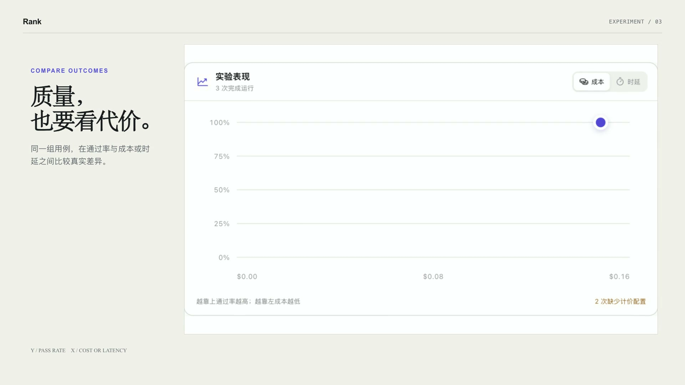

# Chat2Ranker

[](https://www.npmjs.com/package/@xyzbit/chat2ranker) [](https://github.com/xyzbit/chat2ranker/releases/latest) [](https://github.com/xyzbit/chat2ranker/actions/workflows/ci.yml) [](LICENSE)

English | [中文](README.zh.md)

Chat2Ranker is an Agent lifecycle platform for preparing, versioning, evaluating, releasing, and serving Agents. The local product turns a goal into a versioned dataset, comparable Agent runs, inspectable evidence, controlled release aliases, and authenticated text-serving endpoints.

The product keeps evaluation and production on one version lineage: an exact Agent version is tested, promoted to an environment alias such as `production`, resolved once when a request is accepted, and retained in the invocation record. See the [Agent Serving API](rank/docs/serving-api.md) for the implemented subset and the [Agent lifecycle and serving proposal](.agents/notes/proposed/feature/2026-09-08-agent-lifecycle-serving.md) for later phases.

## What can you compare?

- **New models:** keep the dataset, Harness, tools, and judging rules fixed to compare model versions on pass rate, cost, duration, and stability.
- **Harnesses:** run the same model and cases through DeepSeek Harness, Codex, Claude Code, or Hermes to measure runtime differences.
- **Agent configurations:** freely combine models, system prompts, tools, and Skills, then compare the frozen Agent versions in one experiment.
- **Regressions:** repeat trials before a release, find unstable cases, and inspect failures and execution traces.

## See one experiment end to end

[](rank/docs/assets/chat2ranker-demo.mp4)

Describe one goal, let Rank prepare reusable data and Agents, confirm the run, compare quality against cost or duration, and open the side workspace only when you need details. Click the image to play the 1080p video.

<a id="run"></a>

## Start in one minute

Requires Node.js 22.19 or newer on macOS or Linux, x64 or arm64.

```sh
npx -y @xyzbit/chat2ranker@latest start
```

On first open, choose a provider and model, then enter an API key. Describe the outcome you want, such as “Build a Web research dataset and compare two agents on accuracy and cost.” Rank asks only for missing information and waits for explicit confirmation in the run card.

See the [one-minute quick start](rank/docs/quickstart.md) for first-run setup, background operation, and isolated data directories.

## From conversation to production evidence

- **Prepare:** create or select versioned datasets and agent configurations through conversation.
- **Run:** isolate every trial and compare multiple agent versions in one run group.
- **Evaluate:** prefer deterministic checks and invoke rubric-based LLM judging only when semantic evaluation is needed.
- **Inspect:** aggregate pass rate, stable cases, cost, duration, failures, and raw execution artifacts.
- **Release:** promote an evaluated immutable version to `staging` or `production`, with compare-and-swap alias history and recorded evidence or override reasons.
- **Serve:** invoke exact versions or aliases through an authenticated Responses-compatible API for text, image, file, function, and approval interaction, with signed Webhook notifications and recorded output, usage, cost, and release lineage.

## Harnesses and architecture

[DeepSeek Harness](https://github.com/deepseek-ai/deepseek-harness) is the first-party runtime and control-conversation foundation. Pi, Claude Code, Codex, and Hermes connect through peer Runner adapters; an uninstalled or unconfigured Runner is not presented as runnable.

The Go Rank service owns experiments, frozen versions, scheduling, and aggregation. The Execution Service runs candidates and judges in isolated processes or sandboxes. Read the [system architecture](rank/docs/architecture.md) and [core data flow](rank/docs/core-data-flow.md) for details.

## Run from source

```sh
git clone https://github.com/xyzbit/chat2ranker.git
cd chat2ranker
pnpm install
pnpm rank:dev
```

See [local development and acceptance](rank/docs/local-acceptance.md) for source prerequisites, health checks, and acceptance flows. See the [repository structure](rank/docs/project-structure.md) for code ownership.

## Contributing

Issues and pull requests are welcome. If Chat2Ranker is useful to you, consider starring the repository.

Released under the [MIT License](LICENSE).
