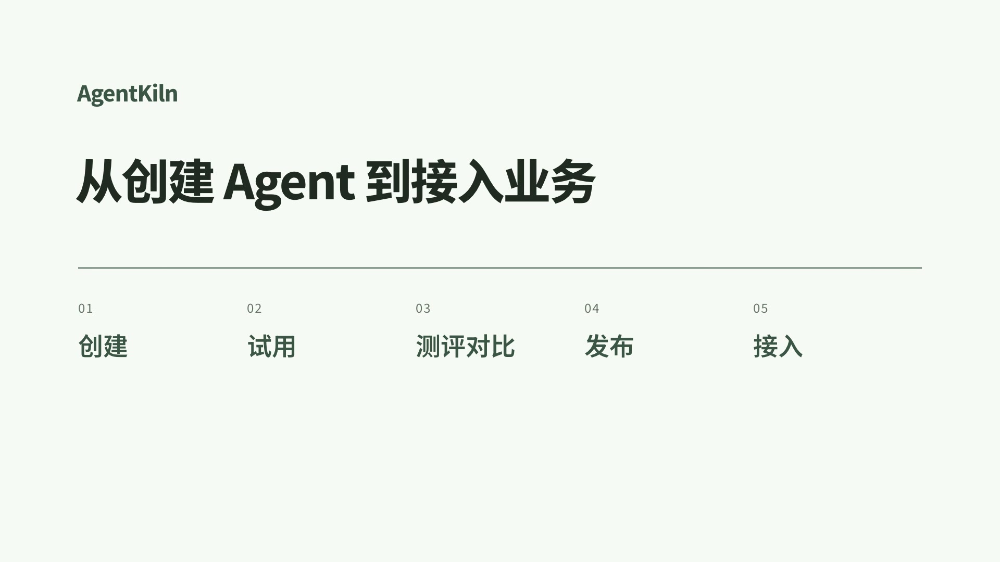
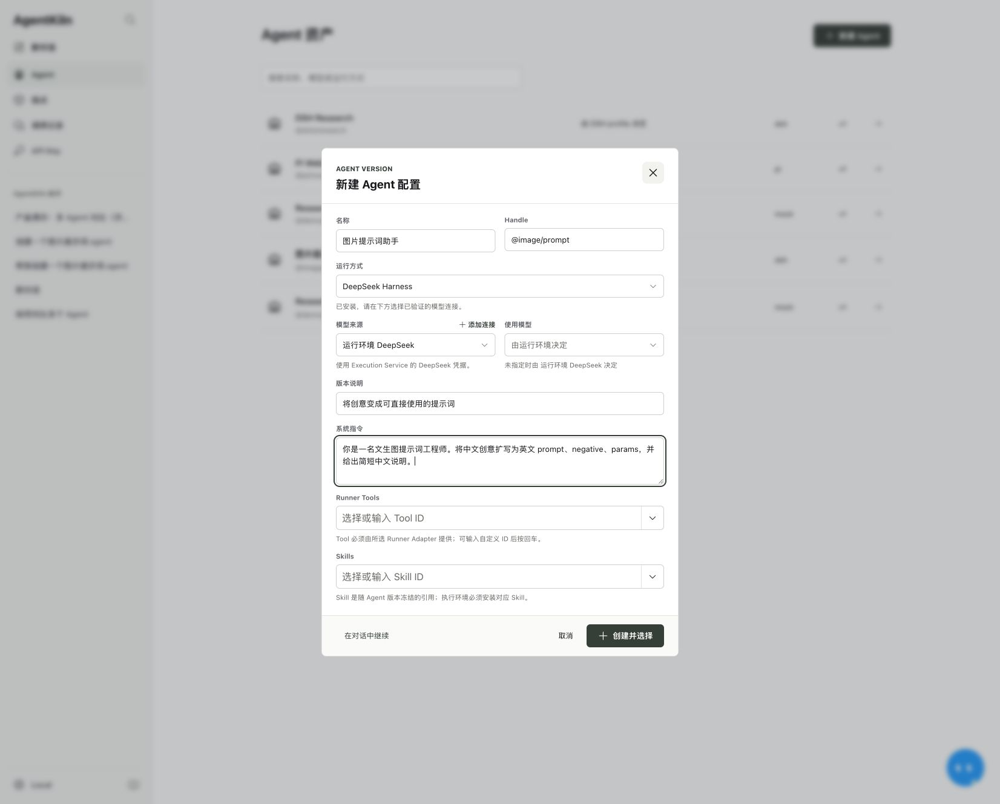
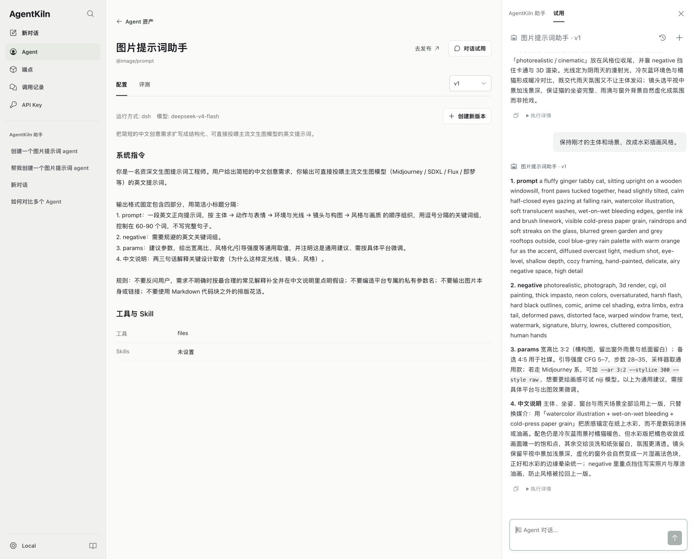
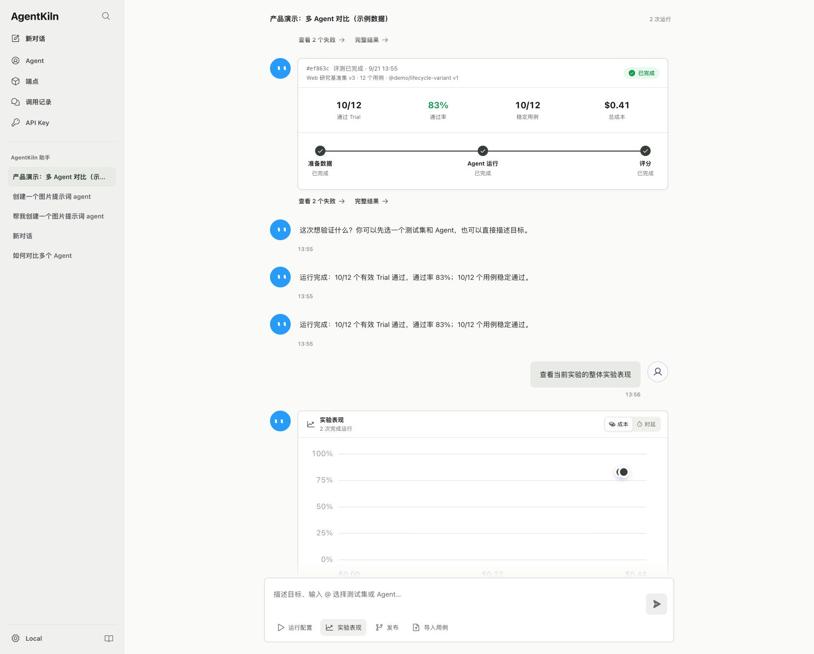
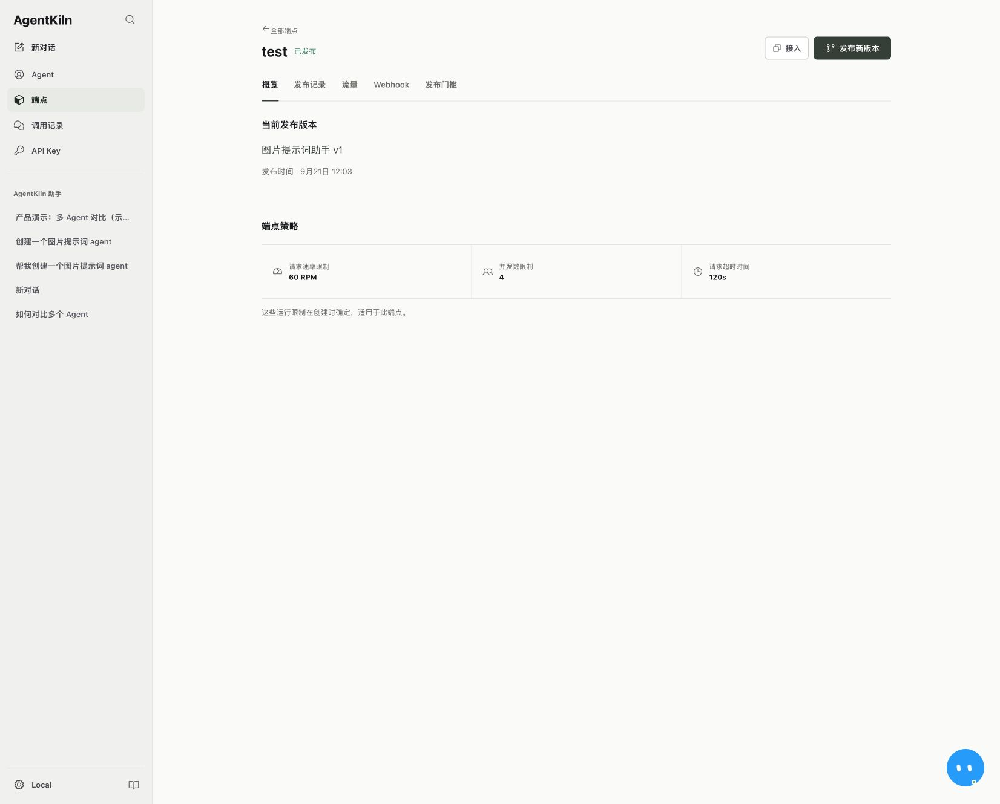
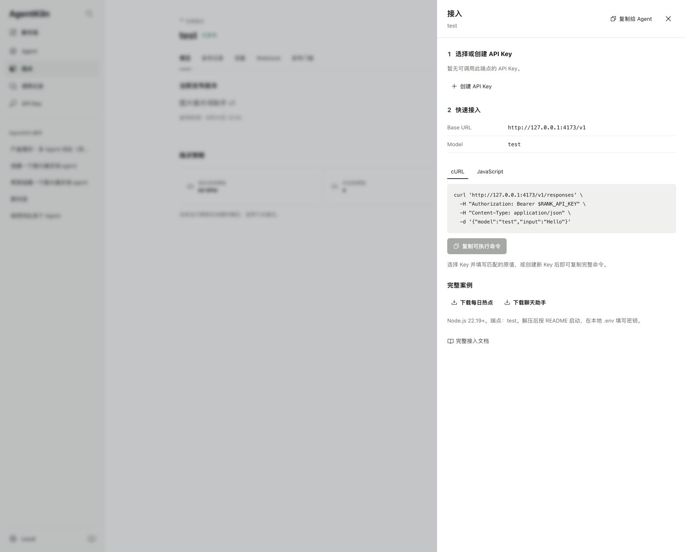

# AgentKiln

[](https://github.com/xyzbit/agentkiln/releases/latest) [](https://github.com/xyzbit/agentkiln/actions/workflows/ci.yml) [](LICENSE)

English | [中文](README.zh.md)

AgentKiln is an Agent development and delivery platform: create an Agent, try it in a conversation, compare versions through evaluation, publish an endpoint, and integrate it into your application. Experiments validate quality as one part of this workflow.

Models, system instructions, tools, and Skills are frozen with each Agent version. Trials, evaluations, and releases refer to that version so you can reproduce behavior, investigate failures, and choose what to ship.

## See the core workflow in 66 seconds

[](rank/docs/assets/agentkiln-lifecycle.mp4)

Click the cover to watch the 1080p video. It uses actual product screens and short Chinese captions without narration. Comparison screens marked “演示数据” use the deterministic Demo Runner to illustrate the workflow; they are not model benchmark results.

## From creation to integration

### 1. Create an Agent

Choose a runtime and model, configure system instructions, tools, and Skills, and save a traceable Agent version. You can also describe your requirements in chat and let AgentKiln prepare the configuration.



### 2. Try it in a conversation

Open the playground from Agent details to hold a multi-turn conversation, inspect execution details, and resume saved history. Trial conversations are stored independently; no dataset or experiment run is required. See [Agent playground](rank/docs/agent-playground.md).



### 3. Evaluate and compare

Use the same dataset to compare Agent versions on pass rate, cost, and duration. Inspect individual cases for outputs, judgments, and execution evidence. A comparison group creates a separate Run for each Agent version.



### 4. Publish an endpoint

Select an Agent version and use regression evaluations and release thresholds to decide whether to publish. Endpoints retain their published version and release history, with updates and rollback. See [release policy](rank/docs/release-policy.md).



### 5. Integrate your application

Open the endpoint integration panel, configure an API key, and call the Responses-compatible interface with cURL or the JavaScript SDK. Streaming, multi-turn context, and invocation records support application integration and debugging. See the [Serving API](rank/docs/serving-api.md) and [runnable client](rank/examples/responses-client/README.md).



<a id="run"></a>

## Start in one minute

Requires Node.js 22.19 or newer on macOS or Linux, x64 or arm64.

This command requires a published AgentKiln npm package and matching runtime release; use the source instructions below before those artifacts are available.

```sh
npx -y @xyzbit/agentkiln@latest start
```

On first open, choose a provider and model, then enter an API key. Describe the outcome you want, such as “Create an image-prompt assistant and let me try it.” AgentKiln asks only for missing information. When you need evaluation, prepare a dataset and confirm the run.

See the [one-minute quick start](rank/docs/quickstart.md) for first-run setup, background operation, and isolated data directories.

## Harnesses and architecture

[DeepSeek Harness](https://github.com/deepseek-ai/deepseek-harness) is the first-party runtime and control-conversation foundation. Pi, Claude Code, Codex, and Hermes connect through peer Runner adapters; an uninstalled or unconfigured Runner is not presented as runnable.

The Go Rank service manages Agent versions, trial sessions, evaluation runs, and deployment endpoints. The Execution Service runs Agents and judges in isolated processes or sandboxes. Read the [system architecture](rank/docs/architecture.md) and [core data flow](rank/docs/core-data-flow.md) for details.

## Run from source

```sh
git clone https://github.com/xyzbit/agentkiln.git
cd agentkiln
pnpm install
pnpm rank:dev
```

See [local development and acceptance](rank/docs/local-acceptance.md) for source prerequisites, health checks, and acceptance flows. See the [repository structure](rank/docs/project-structure.md) for code ownership.

## Contributing

Issues and pull requests are welcome. If AgentKiln is useful to you, consider starring the repository.

Released under the [MIT License](LICENSE).
